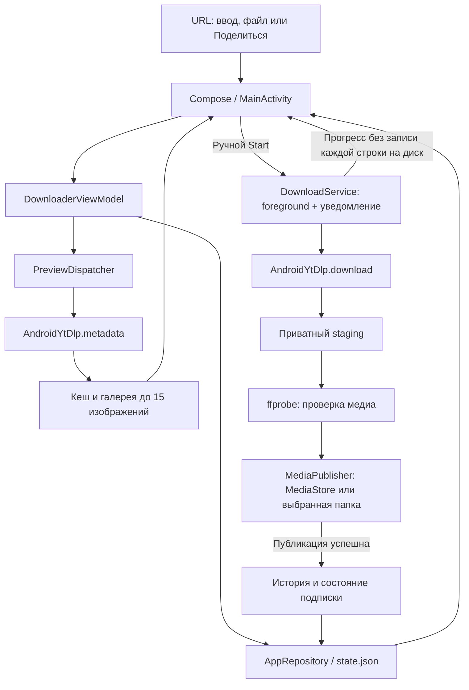
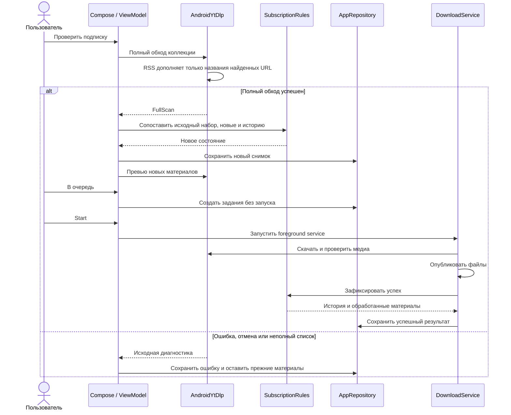

# Video Downloader для Android

Android-приложение находится в [`android/`](../android/) и написано на Kotlin с Jetpack Compose. Оно использует собственное хранилище данных и Android-рантайм yt-dlp/FFmpeg. Windows EXE на телефон не переносится. Сборка устанавливаемого APK описана в [отдельном гайде](../android/README.md).

## Первое скачивание

1. Установи APK на устройство **Android 8.0+**, поддерживающее **arm64-v8a** или **x86_64**.
2. Открой приложение и дождись **«Подготовка загрузчика…»**: при первом запуске распаковываются компоненты рантайма.
3. Во вкладке **«Настройки»** выбери профиль и, при необходимости, папку. Нажми **«Сохранить настройки»**. yt-dlp и FFmpeg уже входят в Android-зависимости; отдельной кнопки установки FFmpeg здесь нет.
4. Во вкладке **«Очередь»** вставь HTTP/HTTPS-адрес в **«URL видео или плейлиста»** и нажми **«Добавить»**. Поддерживаются несколько ссылок, **«Вставить»**, **«Из файла»** для `.txt`/`.url` и отправка текста через Android-меню **«Поделиться»**.
5. Метаданные запрашиваются заранее. Переключатель **«Названия вместо URL»** меняет подписи строк, а нажатие на строку открывает превью. До 15 разных изображений сайта можно листать жестом и кнопками; получение метаданных не запускает скачивание видео.
6. Нажми **Start**. На Android 13+ разреши уведомления, чтобы видеть прогресс и управление загрузками вне приложения. Прогресс также виден во вкладке **«Загрузки»**.

Для одного YouTube-видео используй его адрес `https://www.youtube.com/watch?v=VIDEO_ID`, заменив `VIDEO_ID` и убрав параметр `list`. Для отдельных строк на каждый ролик плейлиста удобнее добавить плейлист как подписку по инструкции ниже. Прямой URL плейлиста в очереди — одна задача yt-dlp; он не превращается автоматически в отдельные записи истории для каждого ролика.

**«Пауза»**, **«Продолжить»** и **«Стоп»** управляют сессией. Продолжение использует сохранённые частичные файлы, когда источник допускает докачку. Ссылка, добавленная через подписку, ждёт отдельного нажатия **Start**. Успешные URL видны в **«Загрузки → История»**; повторный Start для уже скачанной ссылки требует подтверждения.

## Где лежат файлы

| Настройка | Каталог |
| --- | --- |
| По умолчанию, Android 10+ | Системные **Загрузки / VideoDownloader** через MediaStore |
| По умолчанию, Android 8–9 | Внешний каталог приложения `Android/data/ru.bespalov.videodownloader/files/Movies` |
| **«Выбрать папку»** | Каталог, которому пользователь выдал доступ в системном диалоге Android |

Материалы подписки получают подпапку с её кратким именем: например, выбранная папка `Video` и подписка `123` дают `Video/123`. При архивировании добавляется каталог даты. Переименование подписки меняет имя для новых заданий, а уже созданные задания сохраняют выбранное имя. Изменение настроек не переносит существующие видео.

Сначала файл скачивается в приватный staging. Приложение проверяет медиа через ffprobe, затем публикует его в конечный каталог. История и состояние **«Обработано»** появляются после успешной публикации. Существующие результаты сохраняются; для повторной копии подбирается свободное имя.

Каталог приложения на Android 8–9 удаляется вместе с приложением. Для файлов, которые должны пережить удаление приложения, заранее выбери обычную пользовательскую папку. При установке обновления с той же подписью данные приложения сохраняются.

## Подписка и RSS

1. Открой **«Подписки → Добавить»**.
2. Укажи **«URL канала / плейлиста»**. Источник должен поддерживать полное перечисление коллекции установленной версией yt-dlp.
3. Если есть лента, укажи её отдельно в **«RSS / Atom — необязательно»**. Одного URL RSS недостаточно: основной адрес коллекции обязателен.
4. При желании задай **«Краткое имя папки»**. Пустое имя заполнится по метаданным источника после проверки.
5. Выбери, как обработать существующие материалы: без флажка текущий набор станет точкой отсчёта; с флажком **«Все имеющиеся материалы добавить в очередь»** он будет добавлен в очередь.
6. Нажми **«Добавить и проверить»**. При следующих запусках используй **«Проверить»** или **«Проверить все»**.
7. Открой материалы подписки, выбери новые и нажми **«В очередь»**. Скачивание начинается кнопкой **Start**.

Проверка выполняет полный обход через yt-dlp. RSS/Atom только дополняет отсутствующие названия для **точных URL, уже найденных этим обходом**. Ошибка ленты не подменяет полный список укороченным. Ошибка, отмена или неполный обход сохраняют прежний успешный снимок. Общий предел — 10 000 материалов; обычный обход ограничен тремя минутами, специальный сборщик публикаций Pornhub — 500 страницами и 15 минутами. Ограничения сайта и авторизации могут сократить доступную коллекцию или привести к ошибке проверки.

Превью новых материалов ставятся на получение после успешной проверки. Если точный URL ранее успешно скачан вручную, подписка учитывает эту историю и повторно не предлагает его как новый. Для успеха из другой подписки предусмотрено однократное уведомление. Разные варианты URL одного ролика не объединяются по ID.

Проверки запускаются вручную. Расписания и автоматического запуска скачивания нет. Cookies можно подключить через **«Настройки → Cookies → Импорт .txt»**; [инструкция для Android](COOKIES.md#android-cookies). RSS-клиент и клиент изображений не импортируют этот браузерный cookie jar.

## Скачивание при сворачивании

После **Start** загрузками владеет Android **foreground service** с постоянным уведомлением. У неё собственные задания, независимые от экрана приложения. Переход на главный экран, переключение на другое приложение и пересоздание Activity при повороте не служат командой остановки. Из уведомления можно вернуться в приложение и управлять сессией. Служба удерживает частичный WakeLock на время активной работы, чтобы выключение экрана само по себе не переводило CPU в сон посреди загрузки.

Это не обещание бесконечной работы при любых действиях системы. **«Остановить принудительно»**, остановка приложения через системный диспетчер активных приложений и перезагрузка устройства завершают процесс. Загрузка не запускается самостоятельно после них: открой приложение, восстанови очередь и нажми **Start**. На Android 15 при `targetSdk 35` фоновые службы `dataSync` имеют общий системный бюджет до **6 часов за 24 часа**; при системном таймауте служба сохраняет прерванное состояние и завершает работу. Новое открытие приложения пользователем сбрасывает этот бюджет согласно правилам Android.

Некоторые прошивки дополнительно ограничивают фоновые приложения. Если загрузки обрываются именно на твоём телефоне, проверь системные **Настройки → Приложения → Video Downloader → Батарея** и разреши фоновую работу; названия пунктов зависят от производителя. Приложение не требует отключать энергосбережение для всей системы.

### Как проверить сворачивание на своём устройстве

1. Добавь достаточно длинное доступное видео и нажми **Start**. Дождись, когда начнёт расти объём скачанного.
2. Нажми **Home** или переключись на другое приложение. Проверь, что уведомление загрузки остаётся, а объём в нём продолжает меняться.
3. При желании выключи экран на минуту. Затем открой приложение через уведомление и проверь продолжающийся прогресс.
4. Дождись завершения: результат должен открываться из **«Загрузки»**, а точный URL — появиться в истории.

Автоматический сценарий [`foregroundDownloadCompletesAfterPressingHome`](../android/app/src/androidTest/java/ru/bespalov/videodownloader/AndroidPortInstrumentedTest.kt) использует реальный медленный HTTP-сервер в тесте, настоящий Android-рантайм и нажатие Home. Он проверяет готовый читаемый файл и историю при скрытой Activity. Команда запуска — в [гайде сборки](../android/README.md#проверки). Само наличие теста не означает, что он пройден на каждой модели телефона.

## Данные, резервная копия и ограничения

Очередь, настройки, подписки и история находятся в приватном `files/state.json`. Превью имеют собственный кеш, cookies — приватную копию импортированного файла. Windows-файлы `session.json` и `subscriptions.json` не являются форматом Android-импорта.

В **«Настройки»** доступны **«Экспорт резервной копии»** и **«Восстановить из резервной копии»**. Копия переносит состояние приложения, но не содержит видео и сам файл cookies. После переноса заново выбери каталог вывода и импортируй cookies: разрешения системного выбора файлов не переносятся между устройствами. Повреждённый снимок открывается без автоматической перезаписи; для восстановления можно явно импортировать исправную копию.

Android-рантайм отличается от Windows-сборки yt-dlp: браузерная эмуляция `--impersonate chrome` здесь недоступна. Наличие экстрактора в yt-dlp не гарантирует одинаковую доступность каждого сайта на телефоне. При ошибке проверь исходную диагностику в меню задания или **«Журнал»** и доступность материала в браузере; cookies не обходят все ограничения источника.

## Взаимодействие компонентов

Вернуться к [README](../README.md) или [сборке APK](../android/README.md).
