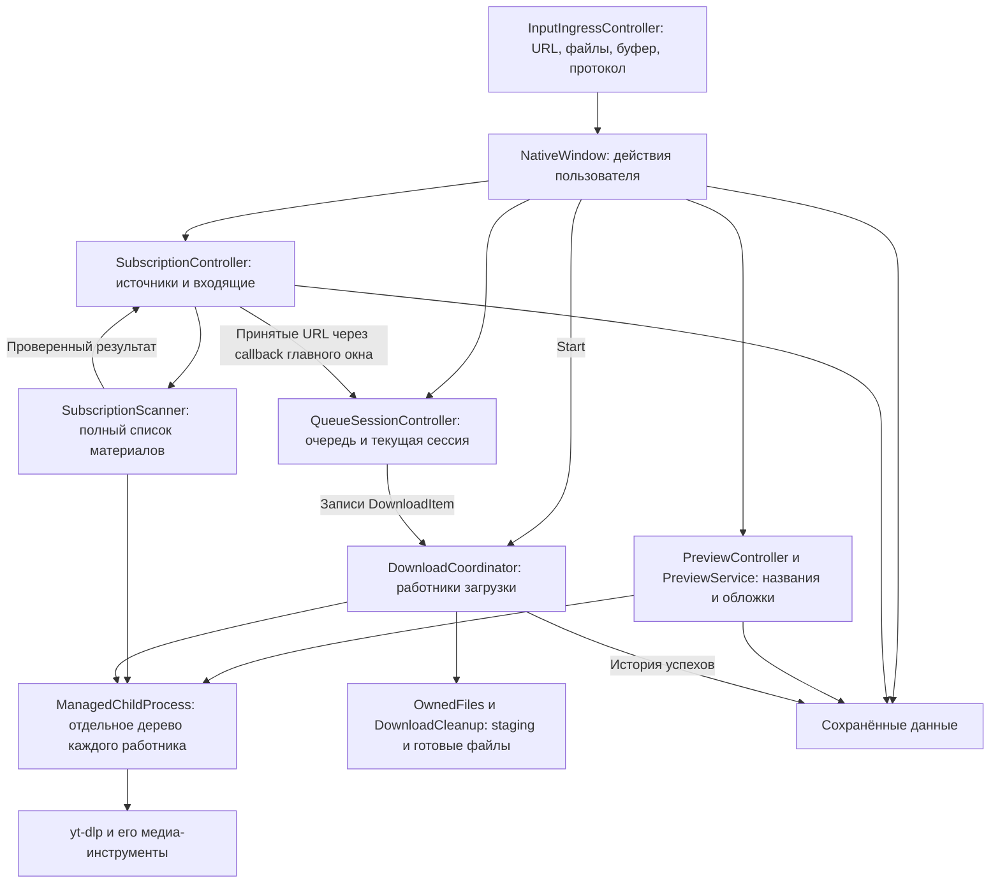
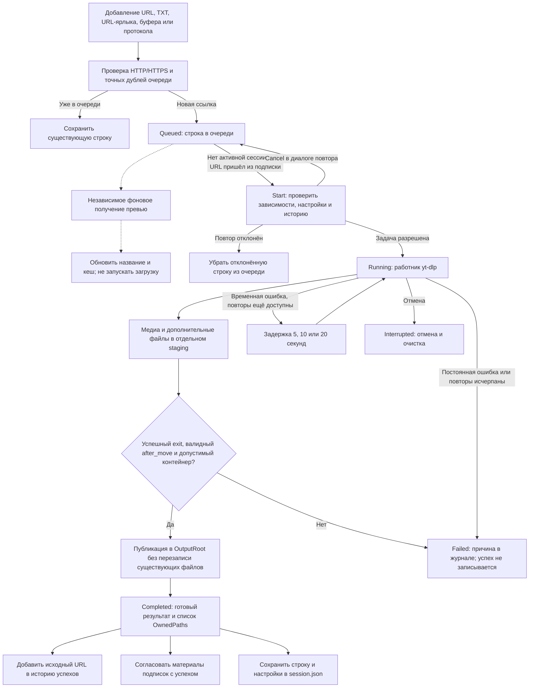
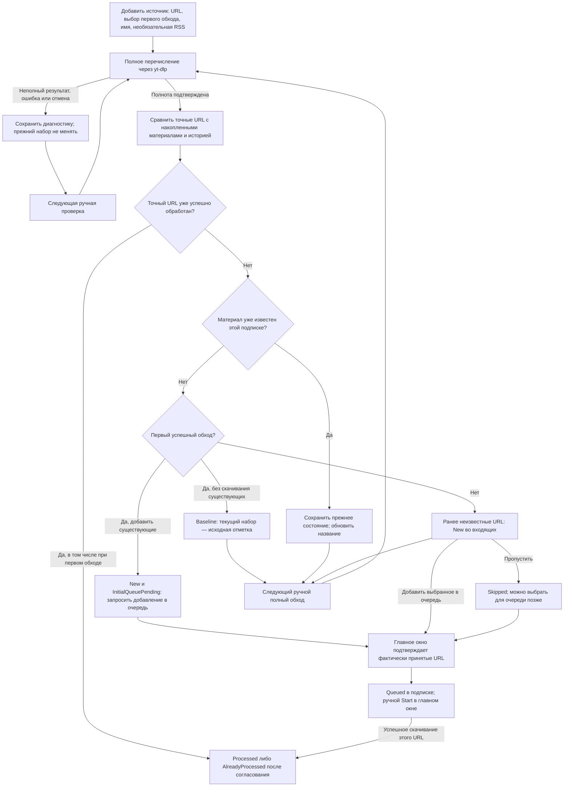
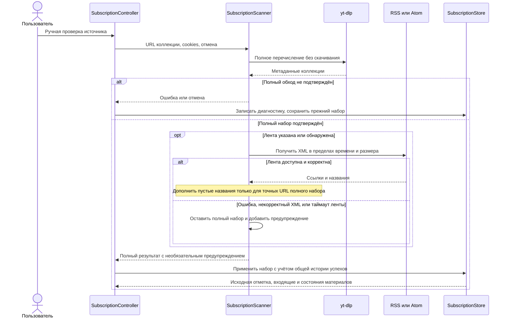
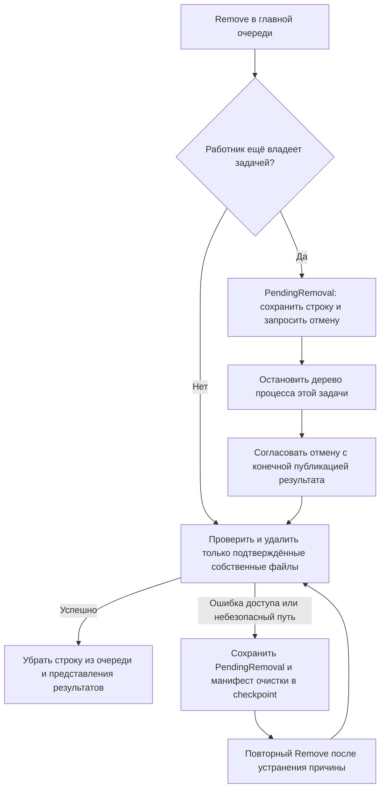
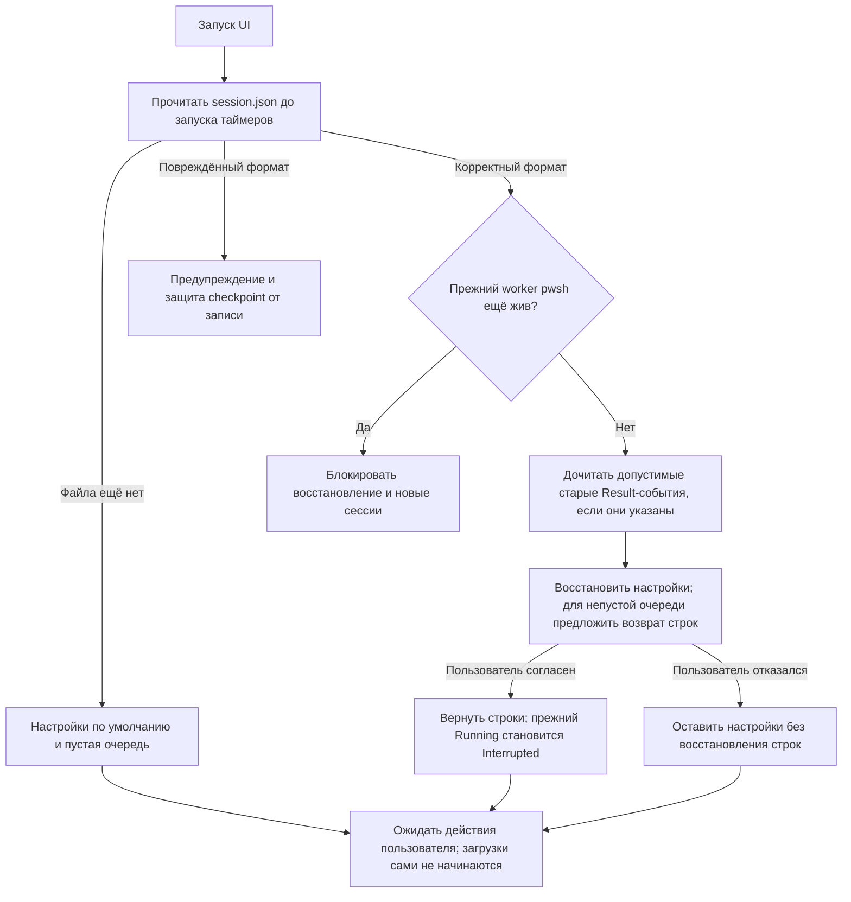

# Как проходит URL через приложение

Этот документ объясняет взаимодействие частей Video Downloader: от добавления
ссылки до сохранённого файла, истории и состояния подписки. Пошаговые действия
в интерфейсе находятся в [руководстве по сценариям](USER_GUIDE.md).

## Основные части

Приложение работает в одном процессе `VideoDownloader.exe`. Превью, проверка
коллекции и скачивание вызывают отдельные процессы `yt-dlp.exe`; получение
метаданных само по себе не скачивает видео. FFmpeg используется для обработки
медиа и, при необходимости, преобразования обложки.

У каждого контроллера свой участок состояния. `WindowLifecycleController`
управляет треем, скрытием и возвращением окна; он не является загрузчиком.
`SubscriptionCheckProgressController` отображает этапы, счётчики и время
текущей проверки. Его таймер обновляет интерфейс, а не запускает новые проверки.

| Участок | Где реализован |
| --- | --- |
| Запуск, единственный экземпляр и передача аргументов | [Program.cs](../src/VideoDownloader/Program.cs) |
| Импорт и буфер обмена | [InputIngressController.cs](../src/VideoDownloader/UI/Controllers/InputIngressController.cs) |
| Связывание UI и команд | [NativeWindow.cs](../src/VideoDownloader/UI/Views/NativeWindow.cs) |
| Очередь и статистика сессии | [QueueSessionController.cs](../src/VideoDownloader/UI/Controllers/QueueSessionController.cs) |
| Превью | [PreviewController.cs](../src/VideoDownloader/UI/Controllers/PreviewController.cs), [PreviewService.cs](../src/VideoDownloader/Preview/PreviewService.cs) |
| Ручные проверки подписок | [SubscriptionController.cs](../src/VideoDownloader/UI/Controllers/SubscriptionController.cs), [SubscriptionScanner.cs](../src/VideoDownloader/Subscriptions/SubscriptionScanner.cs) |
| Загрузка и публикация | [DownloadCoordinator.cs](../src/VideoDownloader/Downloads/DownloadCoordinator.cs), [OwnedFiles.cs](../src/VideoDownloader/Downloads/OwnedFiles.cs) |
| Деревья процессов Windows | [ManagedChildProcess.cs](../src/VideoDownloader/Infrastructure/Windows/ManagedChildProcess.cs) |

## Идентичность ссылки

Очередь и история сравнивают **точную строку URL**. Регистр пути, параметры и
их написание сохраняются; приложение не объединяет разные ссылки по ID видео.
Например, `https://example.org/Video?token=A` и
`https://example.org/video?token=A` — разные адреса.

В подписке материал определяется парой **`SubscriptionId` + точный URL**.
Одинаковый URL может присутствовать в нескольких подписках, а в главной очереди
он представлен одной строкой. Название и обложка — дополнительные сведения:
переключение между отображением URL и названия не меняет адрес задачи.

## Жизненный цикл URL

На схеме показана очередь, ожидающая Start. Присоединение обычного URL к уже
работающей сессии описано ниже; импорт из подписок всегда ждёт следующего Start.

Превью не является обязательным условием Start. После добавления URL его
метаданные запрашиваются сразу, без выбора строки. У `PreviewService` один
независимый работник и кеш на 72 часа; выбор ещё не готовой строки повышает
приоритет её запроса вместо создания второго работника. Ошибка изображения
сохраняет доступные текстовые сведения, а ошибка получения метаданных не стирает
уже известное название из подписки.

Общий запрос превью ограничен 30 секундами, галерея — общими 12 секундами,
2 МБ на картинку и 12 МБ на набор внутри общего бюджета. До 60 кандидатов сайта
дают максимум 15 разных изображений; совпадающие байты удаляются по SHA-256.
Метаданные и картинки передаются в UI по мере готовности; конечный callback
подтверждает завершение запроса. Листание 0,9 секунды при наведении, колесо и
кнопки используют только готовую галерею. Чтение и проверка дискового кеша
выполняются вне UI-потока, а выбранная галерея декодируется для показа отдельно.
Ошибка записи дискового кеша не отбрасывает полученные данные из интерфейса.

Поле `ThumbnailBase64` сохраняет первую обложку для совместимости, массив
`ThumbnailsBase64` содержит галерею; версия данных кеша остаётся 1, версия
получения галереи — 3. Прежняя обложка показывается сразу, обновление набора
запрашивается через того же работника. Строковый кеш в памяти ограничен
64 МиБ и 128 записями, дисковый — мягким пределом 512 МиБ; вытесняются только
служебные JSON с именем SHA-256 URL. TTL до 72 часов не гарантирует хранение
записи до конца этого срока при заполнении кеша.

После успешного `ApplyScan` в ту же очередь превью передаются точные URL
материалов подписки в состояниях `New` / `Queued`. Неполный или отменённый обход
этого не делает. Предзагрузка не меняет состояния, историю, выбор строки и
границу ручного Start; выбор во «Входящих» передаёт URL и уже найденное название
в основной Preview. Панельные ширины `QueuePanelWidth` / `PreviewPanelWidth`
хранятся в настройках `session.json`; Downloads занимает оставшееся место,
устаревшие настройки получают новые значения по умолчанию.

Если обычный URL добавлен во время активной сессии, после проверки истории он
может присоединиться к текущему координатору. После модального диалога приложение
повторно проверяет, что сессия ещё та же и работает. Если она уже завершена или
заменена, ссылка остаётся до следующего Start. **URL из подписок всегда ждут
следующего Start** и не входят в текущую загрузку автоматически.

Готовность превью, 100% прогресса и код завершения процесса по отдельности не
доказывают успех. Нужен существующий медиафайл, сообщённый `after_move`, проверка
его пути и успешная публикация. Файлы с совпадающими именами получают свободный
общий суффикс, например `(2)`; старые файлы не становятся собственностью новой
попытки.

### Одна ссылка на видео и ссылка на плейлист

Прямое добавление URL создаёт одну задачу `DownloadItem`. Ссылка на плейлист
при таком добавлении не разворачивается приложением в отдельные строки:
`yt-dlp` может обработать несколько материалов внутри одной задачи. В превью
запрашивается первый материал плейлиста; история относится к исходному URL
плейлиста, а не к каждой ссылке внутри него. Процент и название одной строки
не являются отдельным отчётом обо всех роликах коллекции.

Для отдельных строк, результатов и истории каждого ролика используется полный
обход через подписку с выбранным добавлением существующих материалов. Это
различие следует из [построения аргументов загрузки](../src/VideoDownloader/Downloads/YtDlpArguments.cs)
и [сканера подписок](../src/VideoDownloader/Subscriptions/SubscriptionScanner.cs).

## Жизненный цикл подписки

Добавление источника сохраняет его определение и сразу запускает первую
проверку как продолжение действия пользователя. Повторные проверки запускаются
вручную. Открытие окна, запуск приложения и таймер отображения прогресса не
проверяют подписки по расписанию.

Новый материал определяется отсутствием точного URL в накопленном наборе этой
подписки. Дата публикации не является главным критерием. Исчезнувшие из
последующего полного списка записи не забываются: их возвращение не создаёт
повторную новинку. Сбой может изменить `LastAttemptUtc` и `LastError`, но не
заменяет предыдущие материалы, исходную отметку и `LastSuccessUtc` частичным
списком.

«Проверить все» обрабатывает источники последовательно и фиксирует каждый
успешный результат отдельно. Отмена не откатывает уже сохранённые результаты
предыдущих источников этой проверки.

Состояния материалов хранятся в
[SubscriptionStore](../src/VideoDownloader/Subscriptions/SubscriptionStore.cs):

| Состояние | Что означает |
| --- | --- |
| `Baseline` | Материал существовал при первом обходе без импорта старых видео |
| `New` | Доступен во входящих; первый импорт может дополнительно иметь `InitialQueuePending` |
| `Queued` | Главное окно подтвердило присутствие в очереди; это ещё не успех загрузки |
| `Skipped` | Пользователь пропустил материал; его можно добавить в очередь позднее |
| `Processed` | Есть подтверждение успешной обработки; происхождение может быть известно или отсутствовать |
| `AlreadyProcessed` | Есть успех и известен другой источник, к которому он отнесён; для этой записи создаётся разовое уведомление |

Успех обычной URL-загрузки тоже учитывается при последующей проверке подписки.
Если известен только факт из общей истории, приложение не придумывает подписку
происхождения: материал получает `Processed`, без сообщения о другом источнике.
При известном другом источнике используется `AlreadyProcessed`; подтверждение
уведомления сохраняется в `DuplicateNotified`.

Ошибка, отмена, исходная отметка, пропуск и постановка в очередь не являются
успешной обработкой. После неудачного скачивания `Queued` в подписке может
остаться `Queued`: состояние конкретной попытки видно в главном окне. При
повторном добавлении уже принятого URL приложение не создаёт вторую строку.

### Папки подписок

При постановке в очередь строка получает `SubscriptionId` и снимок краткого
имени `SubscriptionName`. Базовая папка и дата архивирования фиксируются при
Start. Поэтому источник «123» при `D:\Video` сохраняет материалы в
`D:\Video\123`, а с архивированием — в `D:\Video\ГГГГ-ММ-ДД\123`.
Переименование источника не перенаправляет уже принятые задачи. Смена поля
папки в интерфейсе также не меняет границы удаления старых результатов.

## Как RSS участвует в проверке

RSS/Atom — необязательный источник дополнительных названий внутри подписки на
канал или плейлист. Основной URL коллекции обязателен. Самостоятельной очереди
скачивания всех ссылок из RSS сейчас нет.

При каждой проверке сначала выполняется полный обход, даже если лента не
изменилась. Ссылка, встреченная только в RSS, во входящие не попадает. Лента
заменяет только пустое название или название-заглушку, равное URL; подтверждённое
название полного обхода сохраняется. Отличающиеся параметры URL или другой
регистр пути не считаются совпадением.

Для YouTube адрес Atom может определяться по `channel_id` из метаданных.
Для других источников RSS/Atom задаётся вручную. Cookies передаются процессу
`yt-dlp`; запрос XML ленты выполняет отдельный `HttpClient` без передачи этого
файла cookies.

| Ограничение | Значение |
| --- | --- |
| Материалы полного обхода | Не более 10 000, включая вложенные коллекции |
| Обычная полная проверка | До 180 секунд; время ленты входит в этот общий бюджет |
| Метаданные `yt-dlp` | До 32 МиБ |
| Получение ленты | До 12 секунд и 2 МиБ, в пределах общего времени проверки |
| Отдельный сборщик публикаций Pornhub | До 10 000 видео, 500 страниц, 15 минут и 32 МиБ метаданных |

Если полный обход не завершён, успешная RSS не заменяет его. Если полный обход
успешен, а RSS не работает, полный набор можно сохранить с предупреждением.

## Отмена, удаление и завершение приложения

Для начатых или завершённых загрузок требуется подтверждение удаления. Отмена
не должна завершать работников других URL. `ManagedChildProcess` создаёт
индивидуальное дерево Windows Job Object для каждого работника; GUI, браузер
и открываемые пользователем приложения в такой job не помещаются.

Загрузка сначала пишет в отдельный staging, затем `OwnedFiles` публикует
проверенные файлы и сохраняет список `OwnedPaths`. Очистка использует этот
список, `CleanupPaths`, `StageDir`, `RunDir` и исходный `OutputRoot`. Один старый
`Path` без доказательства владения не разрешает удалить существующий файл.
Выход за границы папки и операции через reparse/junction отклоняются.

При сбое очистки строка остаётся для повторного Remove; Start и Retry не
запускают её заново. Очистка очереди сохраняет задачи с незавершённой очисткой.
Удаление ранее скачанного файла не удаляет запись его успеха из истории.
Окончательный статус отменённой попытки — `Interrupted`, с отображаемым
состоянием `Cancelled`, а не `Failed` или `Completed`.

При выходе через приложение GUI ждёт завершения работников и очистки,
сохраняет конечное состояние и только затем закрывает окно. Скрытие в трей
оставляет сессию активной. Поздние callbacks превью и прогресса подписок
игнорируются после Dispose, отмены или смены соответствующего окна/проверки;
обновление WPF выполняется через Dispatcher.

## Сохранённые данные и восстановление

По умолчанию данные лежат в `%LOCALAPPDATA%\VideoDownloader`. Кнопка
**«📁 Открыть папку настроек»** открывает фактический профиль приложения.
Разработчик может изолировать профиль переменной `VD_DATA_DIRECTORY`.

| Данные | Кто записывает | Кто и зачем читает |
| --- | --- | --- |
| `session.json` | `NativeWindow` через `AppPersistence`: очередь, настройки, результаты и контекст очистки | `AppPersistence.Restore` при запуске; UI восстанавливает настройки и предлагает вернуть очередь |
| `subscriptions.json` | `SubscriptionController` через `SubscriptionStore`: источники, материалы, имена, состояния и подтверждения уведомлений | Проверка, окно подписок, принятие URL в очередь и восстановление недостающих названий |
| `successful-downloads.jsonl` | `DownloadCoordinator` через `AppPersistence.AppendSuccess` и `SuccessfulDownloadHistory` после успешной загрузки | Диалог повтора перед Start/Retry/live Add; согласование подписок с общей историей |
| `preview-cache\<SHA-256 URL>.json` | `PreviewService` после получения метаданных | Предварительное получение названий, выбор строки и повторный запуск; TTL 72 часа |
| `VideoDownloader-<дата-время>-success.txt` и `-error.txt` | `DownloadCoordinator` в базовой папке вывода текущей сессии | Пользовательский журнал итогов; он не заменяет постоянную историю JSONL |
| Staging в `%TEMP%` | Работник отдельной попытки загрузки | Публикация и безопасная очистка; пути незавершённой попытки сохраняются в `session.json` |

Восстановление сохраняет `PendingRemoval`, манифесты файлов, исходные папки и
связь с подпиской. Старое Result-событие не применяется к повторно добавленной
строке `DeferredToNextStart`; недописанный хвост события не доказывает успех.
Повреждённые session, subscriptions и история не исправляются молча. Невалидный
служебный кеш превью можно удалить и получить повторно.

Каждый файл состояния имеет свои правила записи: session заменяется атомарно,
подписки заменяются атомарно под mutex, история дописывается под отдельным
mutex. **Общей транзакции сразу между тремя файлами нет.** Ошибка записи истории
или подписок после реального скачивания отражается в журнале и не превращает
существующий медиафайл в неуспешную загрузку. При следующих действиях подписки
согласуются с доступной общей историей; это не основание игнорировать сообщения
об ошибках сохранения.

Исходники хранения: [AppPersistence](../src/VideoDownloader/Persistence/AppPersistence.cs),
[SuccessfulDownloadHistory](../src/VideoDownloader/Persistence/SuccessfulDownloadHistory.cs),
[SubscriptionStore](../src/VideoDownloader/Subscriptions/SubscriptionStore.cs),
[LegacySessionReader](../src/VideoDownloader/Compatibility/LegacySessionReader.cs).
