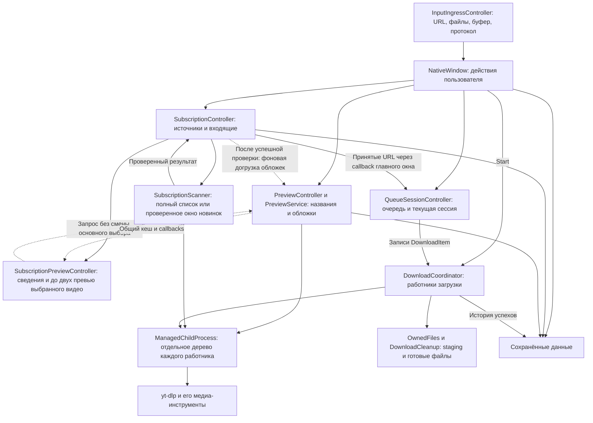
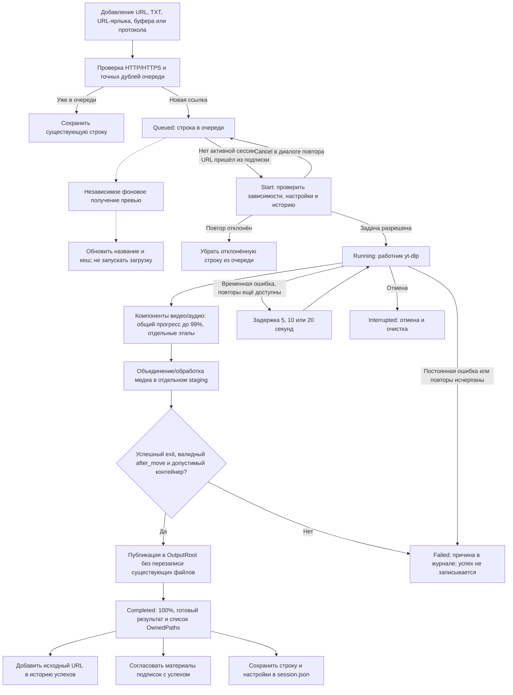
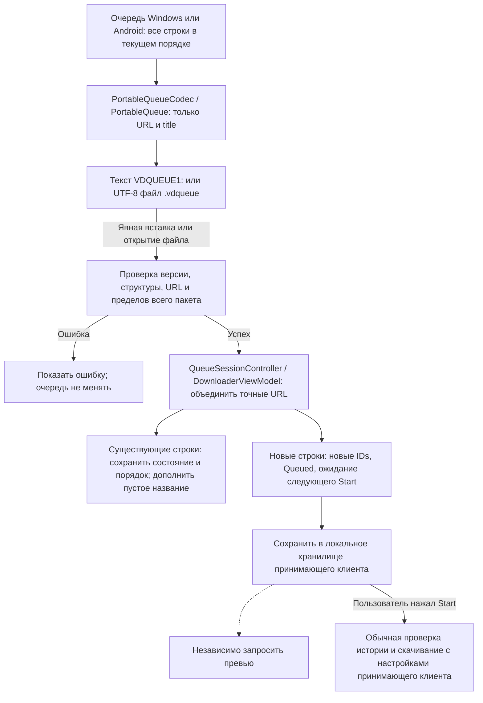
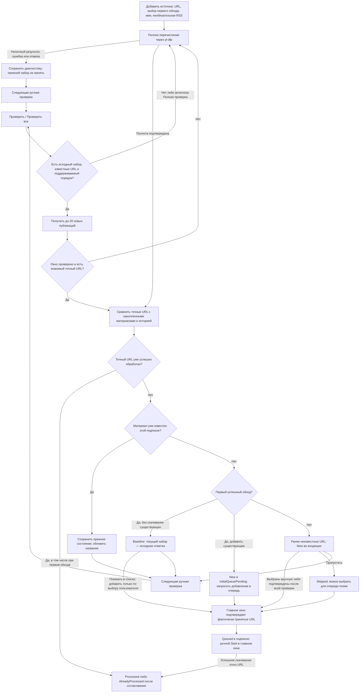
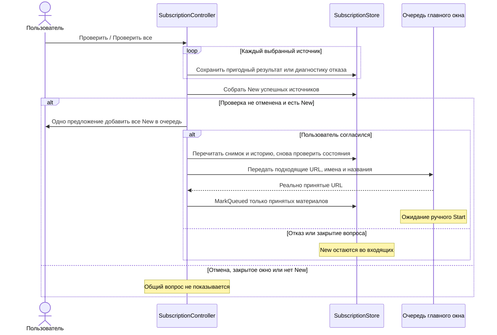
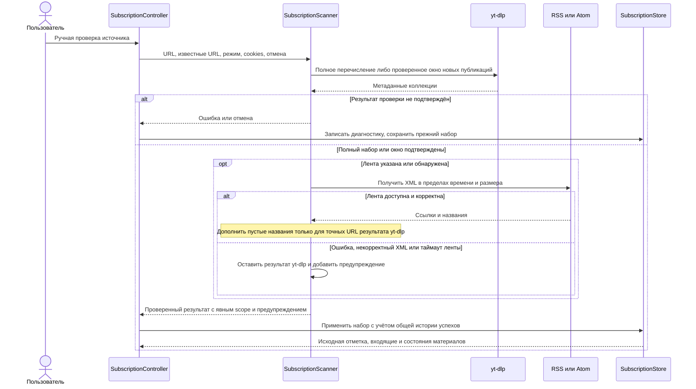
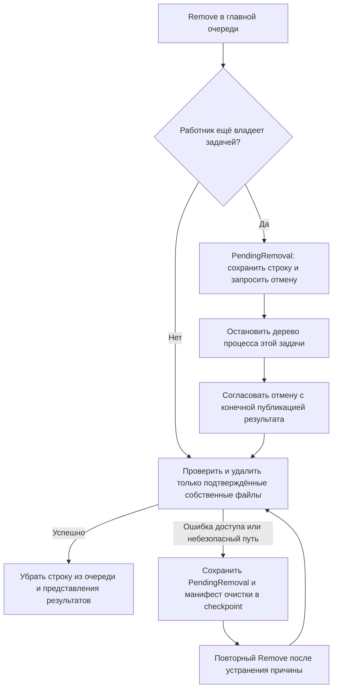
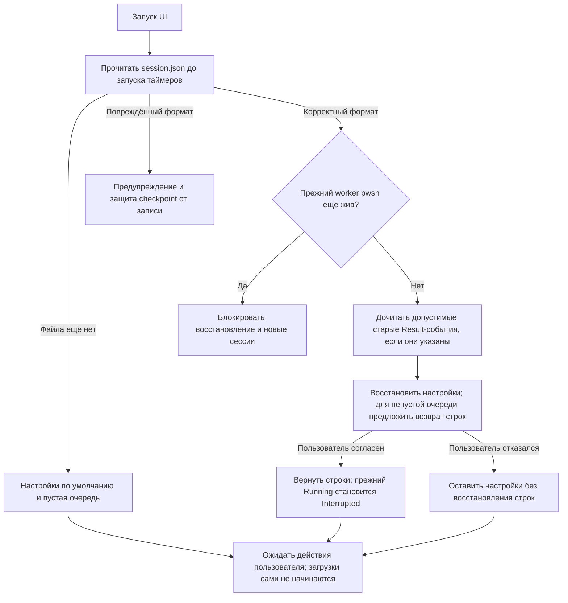

# Как проходит URL через приложение

Этот документ объясняет взаимодействие частей Video Downloader: от добавления
ссылки до сохранённого файла, истории и состояния подписки. Пошаговые действия
в интерфейсе находятся в [руководстве по сценариям](USER_GUIDE.md).

## Основные части

Приложение работает в одном процессе `VideoDownloader.exe`. Превью, проверка
коллекции и скачивание вызывают отдельные процессы `yt-dlp.exe`; получение
метаданных само по себе не скачивает видео. FFmpeg используется для обработки
медиа и, при необходимости, преобразования обложки.

У каждого контроллера свой участок состояния. `WindowLifecycleController`
управляет треем, скрытием и возвращением окна; он не является загрузчиком.
`SubscriptionCheckProgressController` отображает этапы, счётчики и время
текущей проверки. Его таймер обновляет интерфейс, а не запускает новые проверки.

| Участок | Где реализован |
| --- | --- |
| Запуск, единственный экземпляр и передача аргументов | [Program.cs](../src/VideoDownloader/Program.cs) |
| Импорт и буфер обмена | [InputIngressController.cs](../src/VideoDownloader/UI/Controllers/InputIngressController.cs) |
| Связывание UI и команд | [NativeWindow.cs](../src/VideoDownloader/UI/Views/NativeWindow.cs) |
| Очередь и статистика сессии | [QueueSessionController.cs](../src/VideoDownloader/UI/Controllers/QueueSessionController.cs) |
| Превью | [PreviewController.cs](../src/VideoDownloader/UI/Controllers/PreviewController.cs), [PreviewService.cs](../src/VideoDownloader/Preview/PreviewService.cs) |
| Ручные проверки подписок | [SubscriptionController.cs](../src/VideoDownloader/UI/Controllers/SubscriptionController.cs), [SubscriptionScanner.cs](../src/VideoDownloader/Subscriptions/SubscriptionScanner.cs) |
| Общий приём новинок после проверки | [SubscriptionController.QueueOffer.cs](../src/VideoDownloader/UI/Controllers/SubscriptionController.QueueOffer.cs) |
| Сведения о выбранном видео подписки | [SubscriptionPreviewController.cs](../src/VideoDownloader/UI/Controllers/SubscriptionPreviewController.cs) |
| Загрузка и публикация | [DownloadCoordinator.cs](../src/VideoDownloader/Downloads/DownloadCoordinator.cs), [OwnedFiles.cs](../src/VideoDownloader/Downloads/OwnedFiles.cs) |
| Деревья процессов Windows | [ManagedChildProcess.cs](../src/VideoDownloader/Infrastructure/Windows/ManagedChildProcess.cs) |

## Журнал и трассировка прогресса

`DownloadCoordinator` передаёт диагностическому журналу события отдельных заданий: идентификаторы сессии и URL, работник, попытка, качество, источник stdout/stderr, компонент и числовые значения прогресса. Передача событий отделена от изменения очереди и публикации результата. Ошибка диагностического обработчика не меняет результат загрузки.

`NativeWindow` добавляет общую статистику из `QueueSessionController` и показывает ограниченный хвост журнала пакетами через Dispatcher. Выбор профиля действует на новые события и сохраняется в `DownloadOptions.LogProfile`. Фоновая запись в `logs` внутри каталога `AppPersistence` и ротация файлов ограничивают дисковое хранение; вывод журнала не создаёт отдельный процесс yt-dlp.

Каждая per-job трасса добавляет `video_seq` из текущего `DownloadItem.Order` и
`video` с названием либо точным URL при неизвестном названии. Метка маскируется
до JSON-цитирования и ограничивается 160 символами. Общая запись содержит те же
поля в `members` с меткой до 64 символов, не более 32 участников и 2800 символов
списка; `members_shown` / `members_truncated` описывают его полноту. Связи событий
по session/job/worker сохраняются: `job` относится к точному URL, а работник может
позже взять другой материал. Engine `seq` не заменяется номером строки очереди.

`DiagnosticJournal` выводит локальное время `[yyyy-MM-dd HH:mm:ss.fff]`, уровень,
категорию и контекст. Зона и прежний отображаемый `#`-счётчик удалены. Внутренний
`Entry.Sequence` остаётся для выдачи новых записей, порядка и учёта вытеснения;
поля `seq`, `ui_seq` и elapsed внутри трассировки сохраняются. Текстовый префикс
не является инструкцией для цветового оформления обычного TextBox журнала.

`JournalSanitizer` сохраняет разрешённые публичные идентификаторы в query URL,
например `v`, `list` и `viewkey`, и скрывает остальные значения, userinfo,
fragment и поля авторизации. Сообщения журнала сохраняют реальные переносы
строк; продолжения имеют отступ. Корреляционные поля остаются однострочными.
Экран, копирование и текстовые `journal*.log` используют это представление;
сериализация машинных JSONL-событий не меняется.

`QueueSessionController` измеряет длительность сессии монотонными часами.
Отсчёт начинается при Start, включает паузу и фиксируется при завершении
координатора после всех работников и очистки. Следующий запуск сбрасывает
длительность. Фоновое превью и наличие ожидающих URL сами её не увеличивают.

Источником прогресса остаётся структурированный `__VD_PROGRESS__`. Машинный
`before_dl:__VD_PLAN__` сообщает идентичность материала, выбранные форматы и
доступные индекс/число материалов плейлиста. Шкала загрузки усредняет доли
выбранных компонентов с равным весом и масштабирует до 99%; 100% выставляется
только после публикации. Этап и сырой процент компонента показываются отдельно.
При известном размере прямой коллекции учитывается порядок материалов; без
пригодного плана или общего числа возможен процент текущего компонента/материала.

В подробном профиле обычный stdout/stderr сохраняется для диагностики.
Смена компонентов, повторы и уточнение размера остаются видны по сырым данным.
Неизвестный или нечисловой процент не заменяет последнее известное значение
нулём. Настоящие повторы и quality fallback начинают новую попытку с явным
состоянием; ошибка после начала postprocessing не перезапускает всю загрузку.
Общая шкала зависит также от числа заданий текущей сессии.

Профили, сохранение и получение диагностического участка описаны в [руководстве по журналу](LOGGING.md).

## Идентичность ссылки

Очередь и история сравнивают **точную строку URL**. Регистр пути, параметры и
их написание сохраняются; приложение не объединяет разные ссылки по ID видео.
Например, `https://example.org/Video?token=A` и
`https://example.org/video?token=A` — разные адреса.

В подписке материал определяется парой **`SubscriptionId` + точный URL**.
Одинаковый URL может присутствовать в нескольких подписках, а в главной очереди
он представлен одной строкой. Название и обложка — дополнительные сведения:
переключение между отображением URL и названия не меняет адрес задачи.

Адаптеры коллекций формируют адреса вновь обнаруженных материалов:
Pornhub — `https://www.<base-site>/view_video.php?viewkey=<id>`, окно YouTube —
`https://www.youtube.com/watch?v=<id>`, как при полном обходе YoutubeIE.
Для YouTube сначала проверяются источник YoutubeTab, ID и соответствующий ему
watch/shorts/live URL. Это правило обнаружения не переписывает прежние URL
подписок, очереди и истории и не объединяет их по ID.

## Жизненный цикл URL

На схеме показана очередь, ожидающая Start. Присоединение обычного URL к уже
работающей сессии описано ниже; импорт из подписок и переносимой очереди всегда ждёт следующего Start.

Превью не является обязательным условием Start. После добавления URL его
метаданные и обложка сразу ставятся в очередь, без выбора строки. У
`PreviewService` один независимый работник: ожидание предыдущих запросов и
ответа сайта входит во время получения. Выбор ещё не готовой строки повышает
приоритет её запроса вместо создания второго работника. Ошибка изображения
сохраняет доступные текстовые сведения, а ошибка получения метаданных не стирает
уже известное название из подписки.

Общий запрос превью ограничен 30 секундами, галерея — общими 12 секундами,
2 МБ на картинку и 12 МБ на набор внутри общего бюджета. До 60 кандидатов сайта
дают максимум 15 разных изображений; совпадающие байты удаляются по SHA-256.
Метаданные и картинки передаются в UI по мере готовности; конечный callback
подтверждает завершение запроса. Листание 0,9 секунды при наведении, колесо и
кнопки используют только готовую галерею. Чтение и проверка дискового кеша
выполняются вне UI-потока, а выбранная галерея декодируется для показа отдельно.
Ошибка записи дискового кеша не отбрасывает полученные данные из интерфейса.

Поле `ThumbnailBase64` сохраняет первую обложку для совместимости, массив
`ThumbnailsBase64` содержит галерею; версия данных кеша остаётся 1, версия
получения галереи — 3. Прежняя обложка показывается сразу, обновление набора
запрашивается через того же работника. Строковый кеш в памяти ограничен
64 МиБ и 128 записями, дисковый — мягким пределом 512 МиБ; вытесняются только
служебные JSON с именем SHA-256 URL. TTL до 72 часов не гарантирует хранение
записи до конца этого срока при заполнении кеша.

Результат версии получения 3 без картинки и с `ThumbnailError` от сетевого
сбоя, таймаута или повреждённого изображения допускает повтор при следующем
запросе через минуту от `SavedAtUtc`; таймер сам запрос не запускает. Готовая
обложка и отсутствие кандидатов без ошибки используют обычный TTL 72 часа.
Для ошибки отсутствующего FFmpeg сохраняется отдельное правило обновления
после появления конвертера.

После успешного `ApplyScan` в ту же очередь превью в фоне передаются точные URL
для догрузки недостающих обложек независимо от состояния материала, включая
`Baseline`, `Processed`, `AlreadyProcessed` и `Skipped`. Для `Full` используются
подтверждённые текущим `scan.Items` URL; для `RecentWindow` — весь сохранённый
набор источника после применения окна. Неполный, отменённый или не запущенный
из-за паузы обход не начинает такую догрузку. Уже пригодный актуальный кеш
исключает повторный HTTP-запрос; срок данных без кандидатов и минутный cooldown
ошибки обложки сохраняются. Постановка догрузки не ожидает результатов изображений
и не задерживает окончание scan или общее предложение принять новинки в очередь.
Она не меняет состояния, историю, выбор строки и границу ручного Start.
Выбор одного материала во «Входящих» заполняет собственную
правую панель через `SubscriptionPreviewController`, не меняя выбор основного Preview.
Известные название, точный URL, состояние, подписка и время обнаружения показываются
сразу. `GetCached` читает только проверенную память, запрос повышает приоритет того же
единственного работника, а callbacks постепенно добавляют сведения и до двух картинок.
Панель игнорирует данные другой ссылки, очищается при множественном выборе и
отписывается от событий при закрытии; пригодная картинка сохраняется при сбое обновления.
Явное принятие URL из подписки запрашивает превью и для
уже существующей пригодной незавершённой строки очереди: неудачный полный запрос можно
повторить без выбора строки, сохранив дедупликацию работника и готового кеша.
Панельные ширины `QueuePanelWidth` / `PreviewPanelWidth`
хранятся в настройках `session.json`; Downloads занимает оставшееся место,
устаревшие настройки получают новые значения по умолчанию.

Диагностика превью связывает сбой с точным URL видео и кандидата изображения,
его номером и этапом (`metadata`, заголовки, тело, пределы, конвертация или
декодирование). При наличии ответа сохраняются HTTP-статус и доступные размеры,
при исключении — тип и причина, включая причину вложенной ошибки. Значения
проходят обычное маскирование журнала. Отказ отдельного изображения, метаданных
либо записи кеша не меняет итог scan или очереди.

Если обычный URL добавлен во время активной сессии, после проверки истории он
может присоединиться к текущему координатору. После модального диалога приложение
повторно проверяет, что сессия ещё та же и работает. Если она уже завершена или
заменена, ссылка остаётся до следующего Start. **URL из подписок всегда ждут
следующего Start** и не входят в текущую загрузку автоматически.

Готовность превью, 100% прогресса и код завершения процесса по отдельности не
доказывают успех. Нужен существующий медиафайл, сообщённый `after_move`, проверка
его пути и успешная публикация. Файлы с совпадающими именами получают свободный
общий суффикс, например `(2)`; старые файлы не становятся собственностью новой
попытки.

### Одна ссылка на видео и ссылка на плейлист

Прямое добавление URL создаёт одну задачу `DownloadItem`. Ссылка на плейлист
при таком добавлении не разворачивается приложением в отдельные строки:
`yt-dlp` может обработать несколько материалов внутри одной задачи. В превью
запрашивается первый материал плейлиста; история относится к исходному URL
плейлиста, а не к каждой ссылке внутри него. Процент и название одной строки
не являются отдельным отчётом обо всех роликах коллекции.

Для отдельных строк, результатов и истории каждого ролика используется полный
обход через подписку с выбранным добавлением существующих материалов. Это
различие следует из [построения аргументов загрузки](../src/VideoDownloader/Downloads/YtDlpArguments.cs)
и [сканера подписок](../src/VideoDownloader/Subscriptions/SubscriptionScanner.cs).

## Перенос очереди Windows ↔ Android

Обе платформы обмениваются отдельным пакетом с URL и названиями. Windows-сессия
и Android `state.json` остаются разными форматами хранения. Действия пользователя
описаны в [инструкции переноса](QUEUE_TRANSFER.md), точный контракт и общие
фикстуры — в [описании формата](../tests/fixtures/portable-queue/README.md).

Экспорт не изменяет источник. Кодеки проверяют весь пакет до объединения,
сохраняют точную строку URL и первую запись при дублях. Сжатие и разбор выполняются
в фоне; чтение ограничено до завершения распаковки. Неизвестная версия не
передаётся обычному парсеру ссылок. Статусы, подписки, история, пути и cookies не
становятся частью пакета; обычный импорт TXT и URL-ярлыков сохраняется.

Реализации: [C# PortableQueueCodec](../src/VideoDownloader/Persistence/PortableQueue.cs)
и [Kotlin PortableQueue](../android/core/src/main/kotlin/ru/bespalov/video/core/PortableQueue.kt).
Windows-команды находятся в [NativeWindow.PortableQueue.cs](../src/VideoDownloader/UI/Views/NativeWindow.PortableQueue.cs),
Android-команды — в [DownloaderViewModel.kt](../android/app/src/main/java/ru/bespalov/videodownloader/DownloaderViewModel.kt).

## Жизненный цикл подписки

Добавление источника сохраняет его определение и сразу запускает первую
проверку как продолжение действия пользователя. Повторные проверки запускаются
вручную. Открытие окна, запуск приложения и таймер отображения прогресса не
проверяют подписки по расписанию.

Новый материал определяется отсутствием точного URL в накопленном наборе этой
подписки. Дата публикации не является главным критерием. Исчезнувшие из
последующего полного списка записи не забываются: их возвращение не создаёт
повторную новинку. Сбой может изменить `LastAttemptUtc` и `LastError`, но не
заменяет предыдущие материалы, исходную отметку и `LastSuccessUtc` частичным
списком.

Порядок материалов хранится в существующем списке `SubscriptionSnapshot.Items`,
без изменения версии `subscriptions.json`. При успешном Full `ApplyScan`
помещает текущие материалы в порядке `scan.Items`, а отсутствующие исторические
записи сохраняет после них. RecentWindow помещает своё проверенное окно
перед прежним хвостом. Идентичность и состояния строк при перестановке
сохраняются. Окно подписок показывает этот порядок без сортировки по статусу
и времени обнаружения. Для старого накопленного снимка одна полная проверка
обновляет порядок архива; пересоздание подписки не требуется.

Поле выбранного источника показывает исходный точный URL подписки и допускает
выделение для Ctrl+C; отдельная команда копирования использует тот же URL.
Это действие не меняет подписку и не запускает проверку.

Быстрый режим доступен для вкладок YouTube `/videos`, `/shorts`, `/streams`
без query/fragment и для публикаций Pornhub с подтверждённой секцией самых новых
видео. Корневой канал YouTube, произвольные плейлисты и остальные коллекции
используют полный обход: их порядок не считается доказательством свежести.

`SubscriptionScanner` возвращает `SubscriptionScanScope.Full` или
`RecentWindow`. Только полный результат может установить первый baseline.
Проверенное окно применяется как дополнение к прежнему снимку; записи за его
пределами сохраняются вместе с состояниями. При наличии знакомого URL неизвестные
URL из окна становятся `New`. Если все URL известны, новых материалов нет.
При отсутствии пересечения, неподтверждённом порядке или ошибке проверки окна
выполняется полный обход в пределах общего deadline. Ошибка или отмена этого
обхода сохраняет прежний снимок.

Окно 20 не ограничивает число новинок. При 100 известных и 100 новых материалах
первые 20 не пересекаются с прежним набором, поэтому сканер выполняет полный
обход и возвращает 200 записей, из которых все 100 неизвестных становятся `New`.
Прежние `Processed` / `Skipped` и другие решения сохраняются. Полный обход
по-прежнему проверяет общие пределы числа материалов, времени и объёма.

Для сравнения берутся все точные URL подписки, включая `Baseline`, `Skipped`,
`Queued` и успешные. Последняя проверка не обязательно была полной.
Принудительная **«Полная проверка»** позволяет сверить старую часть архива;
окно новых публикаций не обнаруживает вставки за его пределами.

«Проверить все» обрабатывает источники последовательно и фиксирует каждый
успешный результат отдельно. Отмена не откатывает уже сохранённые результаты
предыдущих источников этой проверки.

После окончания batch `SubscriptionController` собирает `New` только успешно
проверенных источников и предлагает один общий приём в очередь в окне
«Новые материалы подписок». В него входят и прежние новинки, оставшиеся без решения;
`InitialQueuePending` обрабатывается отдельно существующим первым импортом.
Отменённый batch, закрытое окно и
отсутствие подходящих материалов не показывают диалог; источники с ошибкой
исключаются. «Не сейчас» либо закрытие вопроса оставляет материалы `New`.

Согласие не вызывает скачивание и не присоединяет ссылки к активной сессии.
Повторное чтение после модального диалога сохраняет актуальные состояния:
материал мог стать обработанным, исчезнуть вместе с подпиской либо уже попасть
в очередь. Приём использует существующее подтверждение фактически принятых URL;
файлы `session.json` и `subscriptions.json` сохраняются отдельно.

Состояния материалов хранятся в
[SubscriptionStore](../src/VideoDownloader/Subscriptions/SubscriptionStore.cs):

| Состояние | Что означает |
| --- | --- |
| `Baseline` | Материал существовал при первом обходе без импорта старых видео; виден как «Исходный снимок», доступен для явного добавления в очередь |
| `New` | Доступен во входящих; первый импорт может дополнительно иметь `InitialQueuePending` |
| `Queued` | Главное окно подтвердило присутствие в очереди; это ещё не успех загрузки |
| `Skipped` | Пользователь пропустил материал; его можно добавить в очередь позднее |
| `Processed` | Есть подтверждение успешной обработки; происхождение может быть известно или отсутствовать |
| `AlreadyProcessed` | Есть успех и известен другой источник, к которому он отнесён; для этой записи создаётся разовое уведомление |

Успех обычной URL-загрузки тоже учитывается при последующей проверке подписки.
Если известен только факт из общей истории, приложение не придумывает подписку
происхождения: материал получает `Processed`, без сообщения о другом источнике.
При известном другом источнике используется `AlreadyProcessed`; подтверждение
уведомления сохраняется в `DuplicateNotified`.

Ошибка, отмена, исходная отметка, пропуск и постановка в очередь не являются
успешной обработкой. После неудачного скачивания `Queued` в подписке может
остаться `Queued`: состояние конкретной попытки видно в главном окне. При
повторном добавлении уже принятого URL приложение не создаёт вторую строку.

### Папки подписок

При постановке в очередь строка получает `SubscriptionId` и снимок краткого
имени `SubscriptionName`. Базовая папка и дата архивирования фиксируются при
Start. Поэтому источник «123» при `D:\Video` сохраняет материалы в
`D:\Video\123`, а с архивированием — в `D:\Video\ГГГГ-ММ-ДД\123`.
Переименование источника не перенаправляет уже принятые задачи. Смена поля
папки в интерфейсе также не меняет границы удаления старых результатов.

## Как RSS участвует в проверке

RSS/Atom — необязательный источник дополнительных названий внутри подписки на
канал или плейлист. Основной URL коллекции обязателен. Самостоятельной очереди
скачивания всех ссылок из RSS сейчас нет.

При каждой проверке сначала выполняется обнаружение через yt-dlp по правилам
полного обхода или окна новинок, даже если лента не изменилась. Ссылка, встреченная только в RSS, во входящие не попадает. Лента
заменяет только пустое название или название-заглушку, равное URL; подтверждённое
название из результата yt-dlp сохраняется. Отличающиеся параметры URL или другой
регистр пути не считаются совпадением.

Для YouTube адрес Atom может определяться по `channel_id` из метаданных.
Для других источников RSS/Atom задаётся вручную. Cookies передаются процессу
`yt-dlp`; запрос XML ленты выполняет отдельный `HttpClient` без передачи этого
файла cookies.

| Ограничение | Значение |
| --- | --- |
| Материалы полного обхода | Не более 10 000, включая вложенные коллекции |
| Обычная полная проверка | До 180 секунд; время ленты входит в этот общий бюджет |
| Окно новых публикаций | До 20 URL; запрос до 30 секунд для YouTube / 45 секунд для Pornhub внутри общего deadline |
| Метаданные `yt-dlp` | До 32 МиБ на процесс |
| Получение ленты | До 12 секунд и 2 МиБ, в пределах общего времени проверки |
| Отдельный сборщик публикаций Pornhub | До 10 000 видео, 500 страниц, 15 минут и 32 МиБ метаданных |

Если проверка коллекции не завершена, успешная RSS не заменяет её. Если
результат yt-dlp подтверждён, а RSS не работает, его можно сохранить с
предупреждением. RSS не превращает окно новых публикаций в полный снимок.

## Отмена, удаление и завершение приложения

Для начатых или завершённых загрузок требуется подтверждение удаления. Отмена
не должна завершать работников других URL. `ManagedChildProcess` создаёт
индивидуальное дерево Windows Job Object для каждого работника; GUI, браузер
и открываемые пользователем приложения в такой job не помещаются.

Загрузка сначала пишет в отдельный staging, затем `OwnedFiles` публикует
проверенные файлы и сохраняет список `OwnedPaths`. Очистка использует этот
список, `CleanupPaths`, `StageDir`, `RunDir` и исходный `OutputRoot`. Один старый
`Path` без доказательства владения не разрешает удалить существующий файл.
Выход за границы папки и операции через reparse/junction отклоняются.

При сбое очистки строка остаётся для повторного Remove; Start и Retry не
запускают её заново. Очистка очереди сохраняет задачи с незавершённой очисткой.
Удаление ранее скачанного файла не удаляет запись его успеха из истории.
Окончательный статус отменённой попытки — `Interrupted`, с отображаемым
состоянием `Cancelled`, а не `Failed` или `Completed`.

При выходе через приложение GUI ждёт завершения работников и очистки,
сохраняет конечное состояние и только затем закрывает окно. Скрытие в трей
оставляет сессию активной. Поздние callbacks превью и прогресса подписок
игнорируются после Dispose, отмены или смены соответствующего окна/проверки;
обновление WPF выполняется через Dispatcher.

## Сохранённые данные и восстановление

По умолчанию данные лежат в `%LOCALAPPDATA%\VideoDownloader`. Кнопка
**«📁 Открыть папку настроек»** открывает фактический профиль приложения.
Разработчик может изолировать профиль переменной `VD_DATA_DIRECTORY`.

| Данные | Кто записывает | Кто и зачем читает |
| --- | --- | --- |
| `session.json` | `NativeWindow` через `AppPersistence`: очередь, настройки, результаты и контекст очистки | `AppPersistence.Restore` при запуске; UI восстанавливает настройки и предлагает вернуть очередь |
| `subscriptions.json` | `SubscriptionController` через `SubscriptionStore`: источники, материалы, имена, состояния и подтверждения уведомлений | Проверка, окно подписок, принятие URL в очередь и восстановление недостающих названий |
| `successful-downloads.jsonl` | `DownloadCoordinator` через `AppPersistence.AppendSuccess` и `SuccessfulDownloadHistory` после успешной загрузки | Диалог повтора перед Start/Retry/live Add; согласование подписок с общей историей |
| `preview-cache\<SHA-256 URL>.json` | `PreviewService` после получения метаданных | Предварительное получение названий, выбор строки и повторный запуск; TTL 72 часа |
| `VideoDownloader-<дата-время>-success.txt` и `-error.txt` | `DownloadCoordinator` в базовой папке вывода текущей сессии | Пользовательский журнал итогов; он не заменяет постоянную историю JSONL |
| Staging в `%TEMP%` | Работник отдельной попытки загрузки | Публикация и безопасная очистка; пути незавершённой попытки сохраняются в `session.json` |

Восстановление сохраняет `PendingRemoval`, манифесты файлов, исходные папки и
связь с подпиской. Старое Result-событие не применяется к повторно добавленной
строке `DeferredToNextStart`; недописанный хвост события не доказывает успех.
Повреждённые session, subscriptions и история не исправляются молча. Невалидный
служебный кеш превью можно удалить и получить повторно.

Каждый файл состояния имеет свои правила записи: session заменяется атомарно,
подписки заменяются атомарно под mutex, история дописывается под отдельным
mutex. **Общей транзакции сразу между тремя файлами нет.** Ошибка записи истории
или подписок после реального скачивания отражается в журнале и не превращает
существующий медиафайл в неуспешную загрузку. При следующих действиях подписки
согласуются с доступной общей историей; это не основание игнорировать сообщения
об ошибках сохранения.

Исходники хранения: [AppPersistence](../src/VideoDownloader/Persistence/AppPersistence.cs),
[SuccessfulDownloadHistory](../src/VideoDownloader/Persistence/SuccessfulDownloadHistory.cs),
[SubscriptionStore](../src/VideoDownloader/Subscriptions/SubscriptionStore.cs),
[LegacySessionReader](../src/VideoDownloader/Compatibility/LegacySessionReader.cs).
