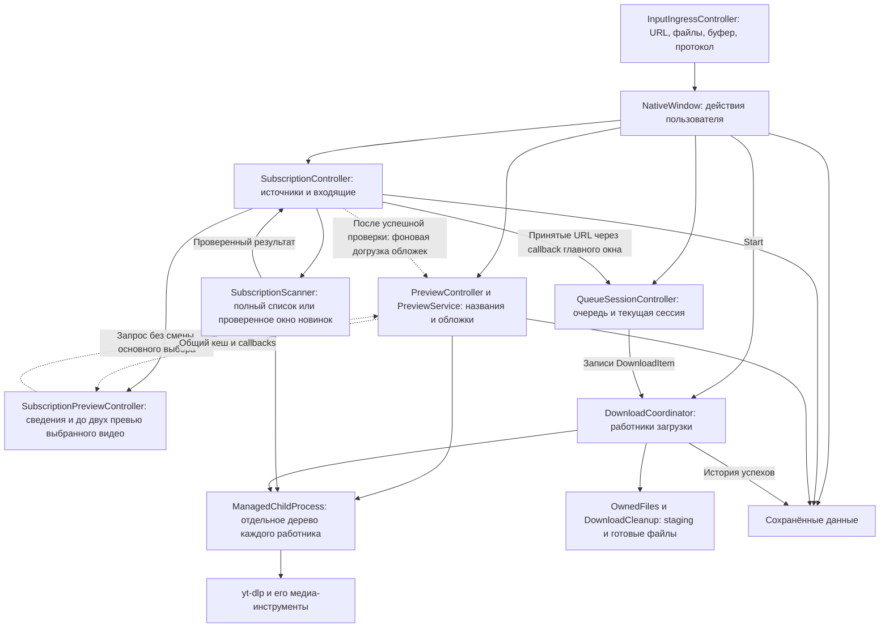
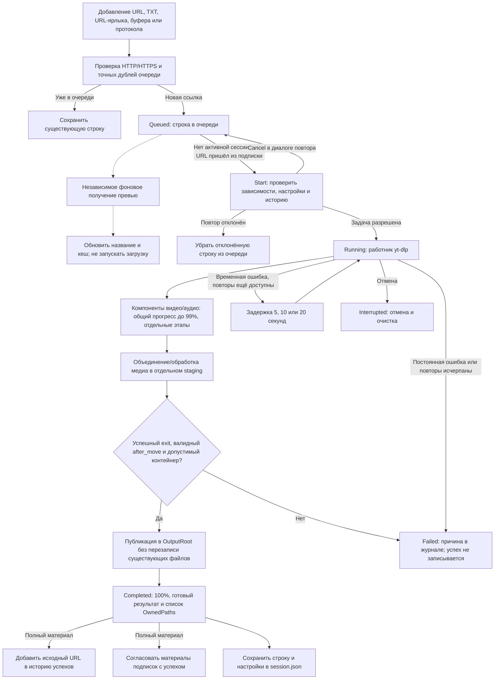
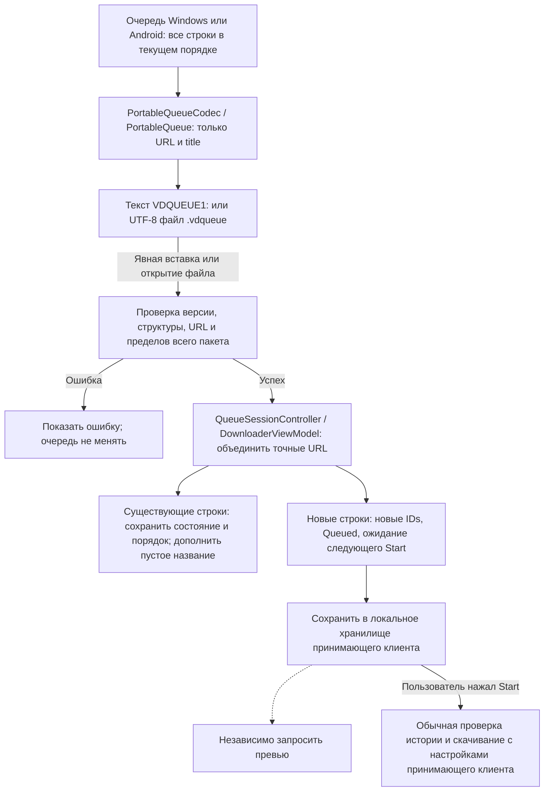
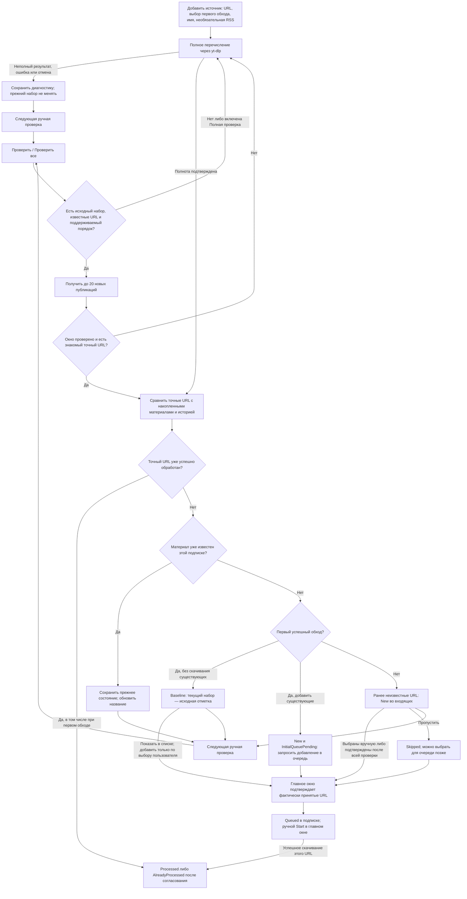
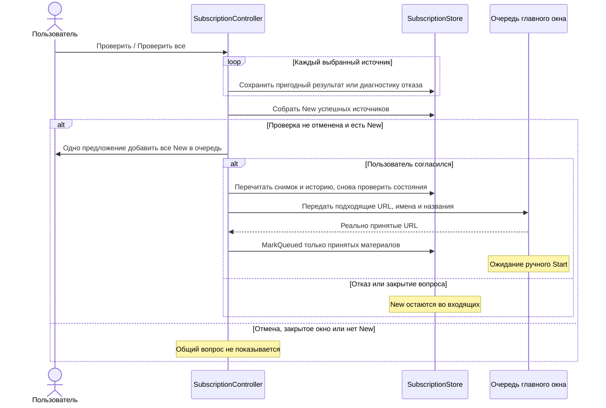
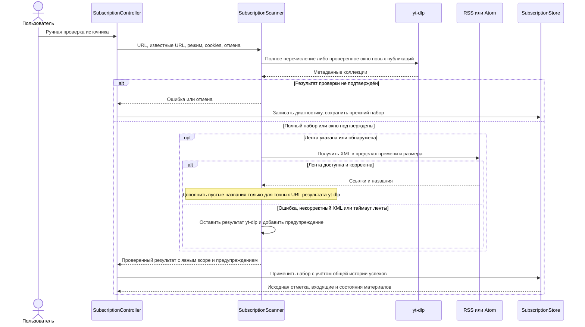
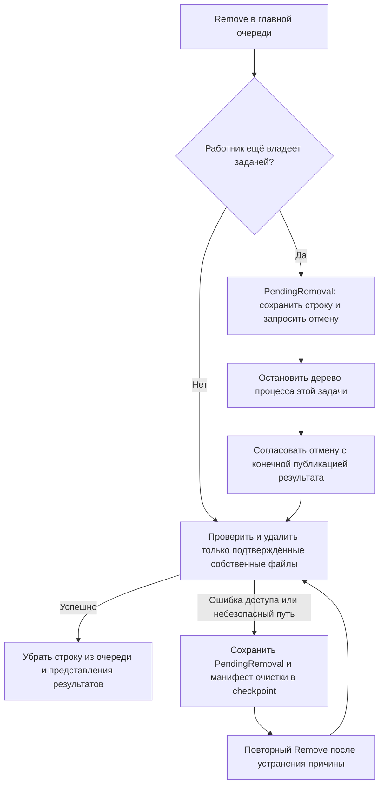
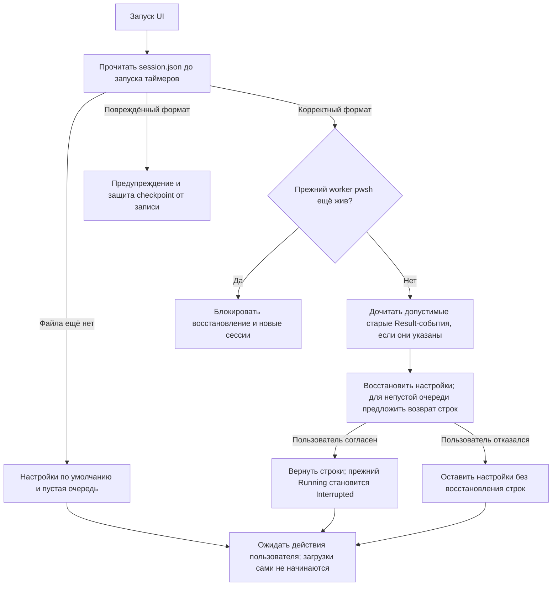

# Как проходит URL через приложение

Документ описывает **Windows-реализацию**: от добавления ссылки до сохранённого
файла, истории и состояния подписки. Общий перенос очереди отдельно отмечен
как контракт Windows ↔ Android. У Android свои служба, публикация и снимок данных;
они показаны в [схемах Android](../user/android.md#взаимодействие-компонентов).
Пошаговые действия Windows находятся в [руководстве по сценариям](../user/windows.md).

## Основные части

Основной процесс приложения — `VideoDownloader.exe`. Превью, проверка
коллекции и скачивание вызывают отдельные процессы `yt-dlp.exe`; получение
метаданных само по себе не скачивает видео. FFmpeg используется для обработки
медиа и, при необходимости, преобразования обложки.

У каждого контроллера свой участок состояния. `WindowLifecycleController`
управляет треем, скрытием и возвращением окна; он не является загрузчиком.
`SubscriptionCheckProgressController` отображает этапы, счётчики и время
текущей проверки. Его таймер обновляет интерфейс, а не запускает новые проверки.

| Участок | Где реализован |
| --- | --- |
| Запуск, единственный экземпляр и передача аргументов | [Program.cs](../../src/VideoDownloader/Program.cs) |
| Импорт и буфер обмена | [InputIngressController.cs](../../src/VideoDownloader/UI/Controllers/InputIngressController.cs) |
| Связывание UI и команд | [NativeWindow.cs](../../src/VideoDownloader/UI/Views/NativeWindow.cs) |
| Очередь и статистика сессии | [QueueSessionController.cs](../../src/VideoDownloader/UI/Controllers/QueueSessionController.cs) |
| Поиск и фильтры представления очереди | [QueueFilterController.cs](../../src/VideoDownloader/UI/Controllers/QueueFilterController.cs), [NativeWindow.QueueFilters.cs](../../src/VideoDownloader/UI/Views/NativeWindow.QueueFilters.cs) |
| Превью | [PreviewController.cs](../../src/VideoDownloader/UI/Controllers/PreviewController.cs), [PreviewService.cs](../../src/VideoDownloader/Preview/PreviewService.cs) |
| Ручные проверки подписок | [SubscriptionController.cs](../../src/VideoDownloader/UI/Controllers/SubscriptionController.cs), [SubscriptionScanner.cs](../../src/VideoDownloader/Subscriptions/SubscriptionScanner.cs) |
| Общий приём новинок после проверки | [SubscriptionController.QueueOffer.cs](../../src/VideoDownloader/UI/Controllers/SubscriptionController.QueueOffer.cs) |
| Сведения о выбранном видео подписки | [SubscriptionPreviewController.cs](../../src/VideoDownloader/UI/Controllers/SubscriptionPreviewController.cs) |
| Загрузка и публикация | [DownloadCoordinator.cs](../../src/VideoDownloader/Downloads/DownloadCoordinator.cs), [OwnedFiles.cs](../../src/VideoDownloader/Downloads/OwnedFiles.cs) |
| Формат и фрагмент отдельного URL | [DownloadSelection.cs](../../src/VideoDownloader/Downloads/DownloadSelection.cs), [MediaSelectionDialog.cs](../../src/VideoDownloader/UI/Views/MediaSelectionDialog.cs), [FragmentTimeline.cs](../../src/VideoDownloader/UI/Views/FragmentTimeline.cs) |
| Деревья процессов Windows | [ManagedChildProcess.cs](../../src/VideoDownloader/Infrastructure/Windows/ManagedChildProcess.cs) |
| Обновление Windows-пакета | [AppUpdateClient.cs](../../src/VideoDownloader/Updates/AppUpdateClient.cs), [AppUpdatePackage.cs](../../src/VideoDownloader/Updates/AppUpdatePackage.cs), [AppUpdateInstaller.cs](../../src/VideoDownloader/Updates/AppUpdateInstaller.cs), [AppUpdateBootstrap.cs](../../src/VideoDownloader/Updates/AppUpdateBootstrap.cs) |

## Обновление Windows-приложения

Проверка стабильного GitHub Latest выполняется в фоне при запуске и вручную;
она не устанавливает обновление. `AppUpdateClient` принимает только более новую
версию официального репозитория, проверяет SHA-256 ZIP из `SHA256SUMS.txt` до
распаковки. `AppUpdatePackage` проверяет корневой `windows-package.json`,
полноту, размеры и хеши файлов. Stage отделён от установленной папки; ссылки,
reparse points, выход за каталог и неожиданные файлы отклоняются. Лимиты сети
и архива перечислены в [контракте выпуска](releases.md#встроенное-обновление-windows).

`NativeWindow.AppUpdate` допускает установку только в состоянии покоя:
завершены работники, Start, проверки подписок, операции зависимостей,
восстановление и очистка; checkpoint доступен для записи. После подготовки
сохраняется checkpoint, прекращается ingress и выполняется обычное закрытие.
Отказ финального сохранения не передаёт управление установщику.

`AppUpdateBootstrap` запускает временную копию автономного EXE после закрытия
окна. Помощник ждёт завершения исходного PID с тем же временем запуска,
захватывает singleton mutex и вызывает `AppUpdateInstaller`. Это внутренний
handoff. До изменения установленного комплекта создаётся и проверяется полная
копия фактических байтов прежних собственных файлов, в том числе изменённого
`yt-dlp.exe`. Durable-запись `.video-downloader-update.json` в папке приложения
связывает установку с собственными stage/backup. Каждая замена выполняется
атомарным переименованием временного файла в каталоге назначения; EXE заменяется
после остальных файлов, а манифест — последним. Посторонние файлы не
перезаписываются. Пользовательский профиль, cookies, загрузки и внешние
FFmpeg/ffprobe не входят в эту замену.

При ошибке замен восстанавливается прежний комплект. После аварийного
завершения следующий startup под singleton проверяет указатель до создания
WPF-окна, preview и чтения/сохранения профиля. Внутренний recovery helper ждёт
завершения запустившего его процесса, восстанавливает старые файлы из проверенной
копии, EXE и манифест, затем перезапускает приложение. Незавершённый rollback
сохраняет указатель и backup в `%TEMP%\VideoDownloaderUpdates` для повторного
восстановления или ручной помощи; повреждённые recovery-данные останавливают
запуск. Первый переход с `v2.0.38` и старых пакетов без `windows-package.json`
выполняется вручную полным ZIP. Механизм относится только к Windows.

После обычного запуска фоновая очистка с задержкой две секунды осматривает
до 32 собственных каталогов обновления. Удаляются только завершённые Applied /
RolledBack без pending-указателя и живого helper; незавершённые, неизвестные
или перенаправленные каталоги сохраняются.

## Журнал и трассировка прогресса

`DownloadCoordinator` передаёт диагностическому журналу события отдельных заданий: идентификаторы сессии и URL, работник, попытка, качество, источник stdout/stderr, компонент и числовые значения прогресса. Передача событий отделена от изменения очереди и публикации результата. Ошибка диагностического обработчика не меняет результат загрузки.

`NativeWindow` добавляет общую статистику из `QueueSessionController` и показывает ограниченный хвост журнала пакетами через Dispatcher. Выбор профиля действует на новые события и сохраняется в `DownloadOptions.LogProfile`. Фоновая запись в `logs` внутри каталога `AppPersistence` и ротация файлов ограничивают дисковое хранение; вывод журнала не создаёт отдельный процесс yt-dlp.

Каждая per-job трасса добавляет `video_seq` из текущего `DownloadItem.Order` и
`video` с названием либо точным URL при неизвестном названии. Метка маскируется
до JSON-цитирования и ограничивается 160 символами. Общая запись содержит те же
поля в `members` с меткой до 64 символов, не более 32 участников и 2800 символов
списка; `members_shown` / `members_truncated` описывают его полноту. Связи событий
по session/job/worker сохраняются: `job` относится к точному URL, а работник может
позже взять другой материал. Engine `seq` не заменяется номером строки очереди.

`DiagnosticJournal` выводит локальное время `[yyyy-MM-dd HH:mm:ss.fff]`, уровень,
категорию и контекст. Зона и прежний отображаемый `#`-счётчик удалены. Внутренний
`Entry.Sequence` остаётся для выдачи новых записей, порядка и учёта вытеснения;
поля `seq`, `ui_seq` и elapsed внутри трассировки сохраняются. Текстовый префикс
не является инструкцией для цветового оформления обычного TextBox журнала.

`JournalSanitizer` сохраняет разрешённые публичные идентификаторы в query URL,
например `v`, `list` и `viewkey`, и скрывает остальные значения, userinfo,
fragment и поля авторизации. Сообщения журнала сохраняют реальные переносы
строк; продолжения имеют отступ. Корреляционные поля остаются однострочными.
Экран, копирование и текстовые `journal*.log` используют это представление;
сериализация машинных JSONL-событий не меняется.

### Диагностика выбранного задания

`JournalRecord` дополнительно передаёт типизированные `Identity`, `Event`,
`Attempt`, `Invocation` и разрешённый снимок `JobDiagnosticSettings`. Полный
SHA-256 вычисляется из точной строки URL; прежний 12-символьный `job` остаётся
в текстовой трассе. Выборка сверяет полный digest и не разбирает естественные
сообщения или короткий `job` как источник принадлежности. `Journal` — отдельный
идентификатор экземпляра журнала, `Sequence` — его монотонный номер; пара
устраняет дубли между диском и памятью. Попытка привязана к журналу, сессии и
фактическому invocation; смена качества начинает новый invocation.

Координатор фиксирует параметры при admission, начале попытки и предупреждении
или ошибке. В снимок входят только известные ID профиля/качества/кодека/
контейнера/форматов, языки, числовые диапазоны и безопасные флаги. `Output`,
cookies, шаблон имени и поля владения отсутствуют в схеме. Поэтому профиль
`Errors` сохраняет параметры ошибок, даже когда начало попытки не записывалось.
Неизвестные сведения остаются неизвестными.

`DiagnosticJournal` хранит текст и типизированную запись в одной очереди и
кольце: суммарно до 5 000 записей / 2 МиБ памяти, до 2 048 записей / 4 МиБ в
очереди файлового работника. `journal*.log` и `job-events*.jsonl` вращаются
парами; три пары ограничены 5 МиБ каждая, общий дисковый предел — 15 МиБ.
Старый текстовый формат остаётся читаемым. Отказ нового sink не меняет результат
загрузки; пропуски и недоступность явно видны в диагностике.

`JobDiagnosticsService` читает только три фиксированных JSONL-файла и кольцо
в фоне, максимум 15 МиБ входа и 64 КиБ на JSON-строку. Снимок ограничен 2 000
последними событиями / 2 МиБ; некорректные записи и вытеснение учитываются.
Два общих слота чтения и таймаут пять секунд ограничивают зависшие обращения:
слот освобождается после завершения самой файловой операции. При таймауте окно
получает доступную память и предупреждение. Старый текст не индексируется и
не превращается в выдуманную историю попыток.

Окно `JobDiagnosticsWindow` закрепляет идентичность строки при открытии и
обновляет изменившийся журнал в фоне. Поиск, уровень и фактическая попытка
фильтруют доступные события; копирование учитывает фильтры. Закрытие отменяет
операции и отбрасывает поздние ответы. Просмотр и экспорт не сохраняют профиль,
очередь или историю и не требуют остановки скачивания.

Асинхронное чтение и экспорт запускаются через `Dispatcher.InvokeAsync`, чтобы
продолжения всегда возвращались в WPF-контекст, включая прямой вызов события
контрола без `Application.Run`. Флаги занятости устанавливаются до постановки
операции в Dispatcher; закрытие ожидает уже опубликованные задачи.

Экспорт фиксирует весь текущий снимок и создаёт только `manifest.json`,
`events.jsonl`, `journal.txt`, `settings.json`, `error.txt` в ZIP до 8 МиБ
несжатых данных. `DiagnosticPrivacy` применяет `JournalSanitizer`, затем скрывает
абсолютные Windows/UNC/Unix-пути и диагностические командные строки. Сырые
`journal*.log` и профиль не копируются. Версии берутся из assembly и ограниченных
собственных `--version` / `-version` процессов: до 8 КиБ на поток, три секунды
на компонент, без сетевого запроса; отмена завершает процесс и оба потока.
Вывод и stderr версии не попадают в пакет. Сохранение использует уникальный
CreateNew temp в выбранной локальной папке, фиксированные имена ZIP entries
и замену лишь после успешного закрытия архива. Существующий файл заменяется
только после явного подтверждения; ошибка или отмена удаляет только свой temp.

`QueueSessionController` измеряет длительность сессии монотонными часами.
Отсчёт начинается при Start, включает паузу и фиксируется при завершении
координатора после всех работников и очистки. Следующий запуск сбрасывает
длительность. Фоновое превью и наличие ожидающих URL сами её не увеличивают.

Источником прогресса остаётся структурированный `__VD_PROGRESS__`. Машинный
`before_dl:__VD_PLAN__` сообщает идентичность материала, выбранные форматы и
доступные индекс/число материалов плейлиста. Шкала загрузки усредняет доли
выбранных компонентов с равным весом и масштабирует до 99%; 100% выставляется
только после публикации. Этап и сырой процент компонента показываются отдельно.
При известном размере прямой коллекции учитывается порядок материалов; без
пригодного плана или общего числа возможен процент текущего компонента/материала.

В подробном профиле обычный stdout/stderr сохраняется для диагностики.
Смена компонентов, повторы и уточнение размера остаются видны по сырым данным.
Неизвестный или нечисловой процент не заменяет последнее известное значение
нулём. Настоящие повторы и quality fallback начинают новую попытку с явным
состоянием; ошибка после начала postprocessing не перезапускает всю загрузку.
Общая шкала зависит также от числа заданий текущей сессии.

Профили, сохранение и получение диагностического участка описаны в [руководстве по журналу](../user/windows-logging.md).

## Представление очереди Windows

`QueueFilterController` предоставляет Windows-таблице собственный `ListCollectionView`
над исходной `QueueSessionController.Queue`. Текст, статус и точный SubscriptionId
задают только predicate представления: порядок, состав и выполнение исходной очереди
не меняются. Представление сохраняет исходные объекты строк: один точный URL,
неизменяемый план фрагментов в пользовательском порядке и владение всеми готовыми
результатами остаются у той же строки. Изменения названия/статуса обновляют видимость через один отложенный
Dispatcher-вызов. Коллекционные подписки обрабатываются по добавленным/удалённым
строкам, без полного обхода очереди на каждом добавлении.

При обновлении вида контроллер сохраняет только видимое выделение и подавляет
повторный вызов preview для тех же строк. Фильтр не создаёт metadata/HTTP-запросов.
Выбранные действия берут снимок видимых выделенных ссылок; глобальные Start,
Retry failed, Clear и экспорт по-прежнему читают исходную коллекцию. Подтверждение
Clear фиксирует полный снимок, поэтому позднее поступившая ссылка не удаляется.
Перестановка строк при активном фильтре запрещена. Поиск и фильтры не записываются
в checkpoint и освобождают обработчики при Dispose.

## Идентичность ссылки

Очередь и история сравнивают **точную строку URL**. Регистр пути, параметры и
их написание сохраняются; приложение не объединяет разные ссылки по ID видео.
Например, `https://example.org/Video?token=A` и
`https://example.org/video?token=A` — разные адреса.

В подписке материал определяется парой **`SubscriptionId` + точный URL**.
Одинаковый URL может присутствовать в нескольких подписках, а в главной очереди
он представлен одной строкой. Название и обложка — дополнительные сведения:
переключение между отображением URL и названия не меняет адрес задачи.

Адаптеры коллекций формируют адреса вновь обнаруженных материалов:
Pornhub — `https://www.<base-site>/view_video.php?viewkey=<id>`, окно YouTube —
`https://www.youtube.com/watch?v=<id>`, как при полном обходе YoutubeIE.
Для YouTube сначала проверяются источник YoutubeTab, ID и соответствующий ему
watch/shorts/live URL. Это правило обнаружения не переписывает прежние URL
подписок, очереди и истории и не объединяет их по ID.

## Жизненный цикл URL

На схеме показана очередь, ожидающая Start. Присоединение обычного URL к уже
работающей сессии описано ниже; импорт из подписок и переносимой очереди всегда ждёт следующего Start.

Превью не является обязательным условием Start. После добавления URL его
метаданные и обложка сразу ставятся в очередь, без выбора строки. У
`PreviewService` один независимый работник: ожидание предыдущих запросов и
ответа сайта входит во время получения. Выбор ещё не готовой строки повышает
приоритет её запроса вместо создания второго работника. Ошибка изображения
сохраняет доступные текстовые сведения, а ошибка получения метаданных не стирает
уже известное название из подписки.

Метаданные preview читаются через `BoundedProcessOutput` параллельно из обоих pipe: максимум 32 МиБ stdout и 2 МиБ stderr по сырым байтам, до декодирования и разбора JSON. Вывод без LF тоже ограничен. При переполнении, ошибке чтения, таймауте или отмене завершается только собственный job; процесс и оба читателя должны завершиться до следующего запроса.

Общий запрос превью ограничен 30 секундами, галерея — общими 12 секундами,
2 МБ на картинку и 12 МБ на набор внутри общего бюджета. До 60 кандидатов сайта
дают максимум 15 разных изображений; совпадающие байты удаляются по SHA-256.
Метаданные и картинки передаются в UI по мере готовности; конечный callback
подтверждает завершение запроса. Листание 0,9 секунды при наведении, колесо и
кнопки используют только готовую галерею. Чтение и проверка дискового кеша
выполняются вне UI-потока, а выбранная галерея декодируется для показа отдельно.
Ошибка записи дискового кеша не отбрасывает полученные данные из интерфейса.

Поле `ThumbnailBase64` сохраняет первую обложку для совместимости, массив
`ThumbnailsBase64` содержит галерею; версия данных кеша остаётся 1, версия
получения галереи — 3. Прежняя обложка показывается сразу, обновление набора
запрашивается через того же работника. Строковый кеш в памяти ограничен
64 МиБ и 128 записями, дисковый — мягким пределом 512 МиБ; вытесняются только
служебные JSON с именем SHA-256 URL. TTL до 72 часов не гарантирует хранение
записи до конца этого срока при заполнении кеша.

Результат версии получения 3 без картинки и с `ThumbnailError` от сетевого
сбоя, таймаута или повреждённого изображения допускает повтор при следующем
запросе через минуту от `SavedAtUtc`; таймер сам запрос не запускает. Готовая
обложка и отсутствие кандидатов без ошибки используют обычный TTL 72 часа.
Для ошибки отсутствующего FFmpeg сохраняется отдельное правило обновления
после появления конвертера.

После успешного `ApplyScan` в ту же очередь превью в фоне передаются точные URL
для догрузки недостающих обложек независимо от состояния материала, включая
`Baseline`, `Processed`, `AlreadyProcessed` и `Skipped`. Для `Full` используются
подтверждённые текущим `scan.Items` URL; для `RecentWindow` — весь сохранённый
набор источника после применения окна. Неполный, отменённый или не запущенный
из-за паузы обход не начинает такую догрузку. Уже пригодный актуальный кеш
исключает повторный HTTP-запрос; срок данных без кандидатов и минутный cooldown
ошибки обложки сохраняются. Постановка догрузки не ожидает результатов изображений
и не задерживает окончание scan или общее предложение принять новинки в очередь.
Она не меняет состояния, историю, выбор строки и границу ручного Start.
Выбор одного материала во «Входящих» заполняет собственную
правую панель через `SubscriptionPreviewController`, не меняя выбор основного Preview.
Известные название, точный URL, состояние, подписка и время обнаружения показываются
сразу. `GetCached` читает только проверенную память, запрос повышает приоритет того же
единственного работника, а callbacks постепенно добавляют сведения и до двух картинок.
Панель игнорирует данные другой ссылки, очищается при множественном выборе и
отписывается от событий при закрытии; пригодная картинка сохраняется при сбое обновления.
Явное принятие URL из подписки запрашивает превью и для
уже существующей пригодной незавершённой строки очереди: неудачный полный запрос можно
повторить без выбора строки, сохранив дедупликацию работника и готового кеша.
Панельные ширины `QueuePanelWidth` / `PreviewPanelWidth`
хранятся в настройках `session.json`; Downloads занимает оставшееся место,
устаревшие настройки получают новые значения по умолчанию.

Диагностика превью связывает сбой с точным URL видео и кандидата изображения,
его номером и этапом (`metadata`, заголовки, тело, пределы, конвертация или
декодирование). При наличии ответа сохраняются HTTP-статус и доступные размеры,
при исключении — тип и причина, включая причину вложенной ошибки. Значения
проходят обычное маскирование журнала. Отказ отдельного изображения, метаданных
либо записи кеша не меняет итог scan или очереди.

Если обычный URL добавлен во время активной сессии, после проверки истории он
может присоединиться к текущему координатору. После модального диалога приложение
повторно проверяет, что сессия ещё та же и работает. Если она уже завершена или
заменена, ссылка остаётся до следующего Start. **URL из подписок всегда ждут
следующего Start** и не входят в текущую загрузку автоматически.

Готовность превью, 100% прогресса и код завершения процесса по отдельности не
доказывают успех. Нужен существующий медиафайл, сообщённый `after_move`, проверка
его пути и успешная публикация. Файлы с совпадающими именами получают свободный
общий суффикс, например `(2)`; старые файлы не становятся собственностью новой
попытки.

### Одна ссылка на видео и ссылка на плейлист

Прямое добавление URL создаёт одну задачу `DownloadItem`. Ссылка на плейлист
при таком добавлении не разворачивается приложением в отдельные строки:
`yt-dlp` может обработать несколько материалов внутри одной задачи. В превью
запрашивается первый материал плейлиста; история относится к исходному URL
плейлиста, а не к каждой ссылке внутри него. Процент и название одной строки
не являются отдельным отчётом обо всех роликах коллекции.

Для отдельных строк, результатов и истории каждого ролика используется полный
обход через подписку с выбранным добавлением существующих материалов. Это
различие следует из [построения аргументов загрузки](../../src/VideoDownloader/Downloads/YtDlpArguments.cs)
и [сканера подписок](../../src/VideoDownloader/Subscriptions/SubscriptionScanner.cs).

### Формат и фрагмент отдельного URL

`DownloadItem.Selection` хранит желаемые параметры следующей попытки: точный URL,
необязательные `DownloadSection`, основной `MediaFormat`, отдельный аудиоформат
и известную длительность. При Start координатор фиксирует неизменяемый снимок.
`CompletedSelection` описывает опубликованный результат, поэтому изменение
следующей попытки не меняет готовый файл, его `OwnedPaths` или прежнюю историю.
Отсутствующие поля старого checkpoint означают полный материал и автоматический
выбор. Обычный Start не перезапускает Completed; для него нужен явный Retry.

Необязательное `DownloadSelection.Sections` содержит неизменяемый
[`DownloadSectionSet`](../../src/VideoDownloader/Downloads/DownloadSectionSet.cs)
с 1–32 диапазонами в пользовательском порядке. Он копирует входной набор,
проверяет миллисекундные границы и отсутствие пересечений, сравнивается по
содержимому и сериализуется ограниченным JSON-конвертером. Прежнее `Section`
читается совместимо; при наличии обоих полей оно совпадает с первым диапазоном.
`EffectiveSections` и `IsPartial` отделяют полный материал от любого списка.
Редактор [`MediaSelectionDialog.Sections`](../../src/VideoDownloader/UI/Views/MediaSelectionDialog.Sections.cs)
хранит локальные черновики и использует прежние поля времени/кадры для выбранной
строки; до «Применить» очередь и опубликованные файлы не изменяются.

Для нескольких диапазонов `YtDlpArguments` передаёт повторяющиеся
`--download-sections` в исходном порядке и уникальный префикс имени из границ в
миллисекундах. У числовых диапазонов yt-dlp нет порядкового `section_number`,
поэтому имя не опирается на это поле. Координатор собирает все `after_move`
маркеры и до `OwnedFiles.Publish` требует ровно по одному различному собственному
непустому медиафайлу на диапазон с нужным контейнером. В режиме `Separate` все медиа и sidecars
публикуются общей транзакцией; `Path` указывает на первый пользовательский
диапазон, `OwnedPaths` — на весь набор. После первого готового медиа автоматический
повтор или quality fallback неполного набора запрещён. Полный URL не попадает в
success-history и подписку Processed. Переносимый формат очереди не расширяется.

Каталог реальных форматов поступает из существующего metadata request
`PreviewService`, без второго процесса для выбора. Он содержит до 1024 последних
пригодных уникальных ID с разрешением, FPS, кодеками, языком, HDR и размером из `filesize`
либо `filesize_approx`; отсутствие размера не превращается в ноль. DRM и
непригодные записи исключаются. При усечении `FormatsTruncated` сообщает UI о
скрытых ранних форматах: число показанных не выдаётся за полный список. Каталог
учитывается в общем бюджете кеша 64 МиБ. Коллекция не предоставляет ID первого элемента
для выбора всей задачи. `RequestFormats` через того же работника один раз
дополняет прежний кеш версии получения 3 без каталога; обычный TTL обложек не
сбрасывается ради открытия окна.

Ручной выбор передаёт точные ID без quality/codec fallback. Видео без звука
требует отдельного audio-only; muxed-поток не принимает второе аудио.
`AudioTrack` должен быть `Default`, а MP3-only требует audio-only основной поток.
Несовместимость выбранных кодеков с MP4/WebM отклоняется до запуска; Auto/MKV
сохраняют возможность выбрать эти потоки без автоматического перекодирования.
Временный повтор сохраняет снимок ID и диапазона.

`DownloadSection` проверяет конечные неотрицательные секунды, `end > start`
и `end <= duration`, когда длительность известна. Аргументы
`--download-sections` и `--force-keyframes-at-cuts` передаются FFmpeg через
yt-dlp. Успешный фрагмент проходит обычную проверку и публикацию, получает
Completed и собственные пути, но не пополняет историю полного URL и не
переводит материал подписки в Processed.

#### Склейка выбранных диапазонов

`DownloadSelection.FragmentOutputMode` хранит `Separate` по умолчанию либо `Merged`; `AllowMergeReencode` допускается только для `Merged` с 2–32 диапазонами. Оба поля фиксируются при admission вместе с остальным выбором; старые checkpoint сохраняют отдельные выходы. [`MediaSelectionDialog.Merge`](../../src/VideoDownloader/UI/Views/MediaSelectionDialog.Merge.cs) держит локальный черновик и до Start объясняет неизвестную пока совместимость, порядок и явное согласие на возможную потерю качества. Субтитры всех трёх режимов отклоняются до admission, поскольку их пересчёт ещё не реализован.

После проверки полного набора [`FragmentMergeService`](../../src/VideoDownloader/Downloads/FragmentMergeService.cs) получает только собственные регулярные локальные файлы staging. [`FragmentMediaProbe`](../../src/VideoDownloader/Downloads/FragmentMediaProbe.cs) ограничивает JSON одним МиБ, 16 потоками и 2048 главами на файл, 4096 главами на план. Нельзя терять видео, одну из максимум восьми аудиодорожек или язык. Для stream copy совпадают фактический demuxer, порядок потоков, extradata hash, кодеки, time base, размеры, FPS, цветовые и аудиопараметры.

При несовместимости требуется ранее зафиксированное `AllowMergeReencode`. [`FragmentMergeService.Pipeline`](../../src/VideoDownloader/Downloads/FragmentMergeService.Pipeline.cs) последовательно нормализует все отрезки, сохраняя оригиналы. MP4/MOV/MKV используют H.264 CRF 18/AAC; WebM — VP9 CRF 24/Opus; остальные разрешённые контейнеры имеют фиксированные совместимые кодеки. Видео приводится к первому размеру с полями, SAR 1, первому FPS, восьмибитному yuv420p. Белый список исходных непрозрачных восьмибитных форматов и отказ для HDR/иной глубины предотвращают неявное срезание глубины/альфа-канала. Разные канальные раскладки, неквадратные пиксели, неизвестный FPS и FPS выше 240 отклоняются. Нормализованные отрезки и общий результат повторно проверяются по числу каналов и известной раскладке; неизвестная многоканальная раскладка не допускает fallback. Язык каждого потока сохраняется даже при отключённых общих метаданных.

Concat-манифест содержит только проверенные локальные пути с экранированием апострофов; управляющие символы запрещены. Протоколы ограничены `file`, demuxer каждого входа фиксирован по probe, MOV external refs выключены. Прямые URL, cookies и заголовки источника не передаются FFmpeg. Встроенная обложка (MP3/MP4/MOV/FLAC) и необязательные общие теги берутся из первого оригинала; прочие контейнеры с обложкой отклоняются, чтобы не превращать attachment в дополнительное видео. Ограниченные главы перебазируются в порядке списка. Sidecars исходных отрезков не публикуются.

Все FFprobe/FFmpeg запущены через `ManagedChildProcess`; stdout/stderr ограничены, обработка имеет общий лимит шесть активных часов, один probe — 30 активных секунд, пауза не расходует эти сроки. Координатор регистрирует каждого ребёнка для pause/cancel, join предшествует возврату и очистке. Ошибка не запускает повторную загрузку диапазонов или скрытый quality fallback.

Один готовый файл проверяется на непустоту, реальный контейнер, все дорожки и суммарную длительность с небольшим допуском упаковки. Только его отдельный подкаталог передаётся `OwnedFiles.Publish`; оригиналы, нормализованные файлы и служебные манифесты остаются во внешнем staging и очищаются владельцем. Публикация/rollback/отмена сохраняют общие правила точного владения и коллизий. `CompletedSelection` остаётся частичным: библиотека полной истории и подписка Processed не пополняются.

#### Кадры начала и конца фрагмента

[MediaSelectionDialog.Timeline.cs](../../src/VideoDownloader/UI/Views/MediaSelectionDialog.Timeline.cs) связывает существующие локальные поля начала/конца с двумя ручками [FragmentTimeline](../../src/VideoDownloader/UI/Views/FragmentTimeline.cs). Контрол только вычисляет диапазон, рисует шкалу и обрабатывает WPF Drag/Key-события; он не читает диск, не получает метаданные и не применяет выбор к строке. Изменение ручки переписывает оба поля, а обычный `TextChanged` обновляет прежние карточки кадров. Обратная синхронизация не порождает рекурсивные события диапазона. Так же можно редактировать текущий выбранный диапазон без зависимости шкалы от формата хранения `Selection`.

[FragmentTimelineTiming](../../src/VideoDownloader/Downloads/FragmentTimelineTiming.cs) сохраняет миллисекундную точность и привязывает шаг к индексу кадра при известном FPS, чтобы дробные 29.97 FPS не накапливали ошибку округления. Источник FPS — точный выбранный видеоформат либо единственное общее значение всех пригодных видеоформатов; иначе UI явно использует 0.1 секунды. Шкала требует известной длительности, но валидные введённые поля можно пошагово уточнять и без неё. Read-only, коллекция и закрытие повторно проверяются в обработчиках, а не только свойством `IsEnabled`; `Apply` остаётся единственной границей изменения строки и checkpoint.

[MediaSelectionDialog.Frames.cs](../../src/VideoDownloader/UI/Views/MediaSelectionDialog.Frames.cs)
держит две независимые карточки для захваченного точного URL строки. После
изменения времени запрос откладывается на 350 мс; прежний запрос этой карточки
отменяется, изображение очищается. Счётчик поколения и token не позволяют
позднему ответу заменить новый кадр, в том числе при смене формата, закрытии
или запрете редактирования строки. Подпись «Кадр около…» показывает фактическое
время выборки; для конца используется кадр перед границей.

Пустое, неразбираемое или выходящее за известную длительность время очищает
соответствующую карточку без запроса источника. Коллекция и выбранный аудиоформат
получают объяснение отсутствия кадра. Поля проверяются независимо; сравнение
границ `end > start` остаётся частью обычной проверки при «Применить».
«Обновить кадры» повторяет запросы, а ошибка кадра сама по себе не запрещает
применение пригодного диапазона. Ввод времени и получение кадров не создают
задачу загрузки, файлы результата или запись истории.

`PreviewController.GetFrameAsync` передаёт запрос
[MediaFrameService](../../src/VideoDownloader/Preview/MediaFrameService.cs):
единственный работник FFmpeg получает один PNG. Прямой видеопоток разрешает
[PreviewService.FrameSources](../../src/VideoDownloader/Preview/PreviewService.FrameSources.cs)
через существующего единственного metadata-работника yt-dlp, без отдельного
параллельного работника. Разрешённые адреса, заголовки и временные cookies остаются в
памяти, отдельно от сохраняемого `PreviewData`; срок — две минуты с учётом
контекста файла cookies. Для ручного видео-ID требуется именно этот поток;
автоматический режим может выбрать меньший пригодный поток для кадра.

[BoundedMediaProxy](../../src/VideoDownloader/Preview/BoundedMediaProxy.cs)
даёт FFmpeg только случайный loopback-адрес и пересылает ограниченные HTTP
Range-запросы. Поддерживаются прямые HTTP(S)-потоки MP4/MOV/M4V/WebM/MKV;
коллекции, аудио, DRM и live возвращают объяснение отсутствия кадра.
Cookies передаются с учётом домена, пути и флага Secure; при переходе
на другой origin приватные заголовки исходного сервера не пересылаются.
Сервер, игнорирующий ненулевой Range, не вызывает последовательную загрузку
всего материала.

[ManifestFrameMedia](../../src/VideoDownloader/Preview/ManifestFrameMedia.cs)
разбирает завершённые HLS и статические DASH в приложении. HLS поддерживает
master/media, TS, fMP4/init, byte range и AES-128 для TS; DASH —
SegmentTemplate с duration/SegmentTimeline, SegmentList с init/диапазонами и
SegmentBase для одного seekable-файла. Из манифеста выбирается небольшое окно
видеосегментов около нужного времени. Манифест, ключи и сегменты входят в общий
лимит передачи; исходные адреса и авторизация остаются в памяти. Сегменты
проверяются и собираются в двоичные TS/fMP4/WebM, затем локальное реле отдаёт
их FFmpeg с фиксированным demuxer. Удалённый XML/M3U8 и ссылки на вложенные
ресурсы не передаются декодеру, поэтому он не может выйти за транспортный
лимит через вложенный плейлист. XML DTD запрещён, live/DRM и неподдержанные
схемы отклоняются до декодирования. Зашифрованный HLS fMP4 пока не поддержан.

Общий бюджет запроса — 30 секунд, включая ожидание работника и метаданных;
передача медиа ограничена 16 МиБ, stdout PNG — 1 МиБ, stderr — 128 КиБ.
FFmpeg работает в собственном `ManagedChildProcess`, выдаёт один кадр не более
640 × 360 без увеличения; отмена завершает собственный процесс и HTTP-реле
с ожиданием читателей/обработчиков. Для конечной границы используется
`max(0, end - 1/FPS)`, а при неизвестном FPS — отступ 50 мс. Выборка служит
ориентиром и подписывается «Кадр около…».

#### Короткое воспроизведение выбранного диапазона

[MediaSelectionDialog.Playback.cs](../../src/VideoDownloader/UI/Views/MediaSelectionDialog.Playback.cs) запрашивает первый или последний отрывок до 15 секунд, сохраняя исходные границы редактора. Поколение запроса и cancellation не дают позднему ответу заменить актуальный. Поля, формат, read-only и закрытие отменяют подготовку. [WpfMediaClipPlayer](../../src/VideoDownloader/UI/Views/MediaClipPlayer.cs) использует настоящий `MediaElement` с явными Play/Pause/Stop/Position и освобождает Source до удаления клипа. Apply независим от готовности или ошибки проигрывателя; аппаратная доступность кодеков и звука Windows не предполагается.

[MediaClipService](../../src/VideoDownloader/Preview/MediaClipService.cs) сериализует подготовку H.264/AAC MP4 до 640 × 360. [PreviewService.ClipSources.cs](../../src/VideoDownloader/Preview/PreviewService.ClipSources.cs) получает видео и отдельное аудио одним снимком того же metadata-работника и cookie-контекста, хранит источники только в памяти две минуты (четыре URL, 128 форматов, 256 КиБ строк на URL). Отсутствующий в ограниченном кеше ручной ID вызывает повторное извлечение с его удержанием; известный отказ кешируется. Языковой/оригинальный выбор также удерживается при повторном извлечении. Поздний waiter, для которого не были удержаны форматы, ждёт следующую итерацию этого же работника.

Манифесты компилируются тем же ограниченным транспортом в двоичное окно всего короткого диапазона. Разрывы периода/init и временной шкалы отклоняются. FFmpeg и FFprobe видят только случайные локальные реле; неизвестный состав дорожек проверяется ограниченным FFprobe перед построением обязательных maps. Суммарный входной бюджет 64 МиБ (по 32 МиБ при раздельном видео/аудио) включает манифесты, ключи, init, сегменты, probe и чтение декодера. Deadline 60 секунд включает очередь и метаданные; stdout/stderr и итоговый файл ограничены. Все дочерние процессы принадлежат `ManagedChildProcess`, отмена дожидается процессов, pipe readers и HTTP-обработчиков.

[MediaClipCache](../../src/VideoDownloader/Preview/MediaClipCache.cs) резервирует только созданные через CreateNew GUID-файлы в `preview-cache/playback`; sidecar хранит лишь схему, PID и время начала процесса. До четырёх lease учитываются до фактического удаления, включая заблокированные Windows-файлы; после ограниченных повторов следующий запрос пробует очистку снова. При следующем процессе очищаются только распознанные пары с умершим владельцем, PID reuse проверяется временем начала. Чужие файлы не удаляются и учитываются при проверке объёма. Воспроизведение не пишет queue/history/Selection и не владеет опубликованными результатами.

#### Измеренная звуковая волна у границ

[MediaSelectionDialog.Waveform](../../src/VideoDownloader/UI/Views/MediaSelectionDialog.Waveform.cs) по явной кнопке запрашивает до 15 секунд около начала или конца. При неизвестной длительности конец получает только предшествующий участок, начало не выходит за выбранный конец. [AudioWaveformView](../../src/VideoDownloader/UI/Views/AudioWaveformView.cs) рисует peak/RMS bins на исходной временной оси; щелчок, Thumb и клавиатура меняют соответствующее поле черновика, а Apply остаётся единственным сохранением Selection. Собственный drag сохраняет фиксированное измеренное окно и захват мыши. Смена другого поля, формата, языка, cookies, строки диапазонов, read-only и закрытие отзывают поколение; обновление одного SavedAtUtc не отменяет совпадающий контекст.

[MediaWaveformService](../../src/VideoDownloader/Preview/MediaWaveformService.cs) имеет один работник и использует тот же экземпляр `MediaClipService`, metadata-работник и ограничения четырёх lease/64 МиБ. Отдельный owned клип волны не передаётся плееру. Временный retention на `MediaClipPreview` откладывает cleanup даже при Dispose сервиса до завершения потребителя; decoder и обе pipe завершаются перед release. FFmpeg читает только этот локальный MP4 с фиксированным demuxer и протоколом file. Декодирование ограничено 10 секундами, общий запрос — 60 секундами, включая очередь и подготовку.

Реальный PCM S16LE 48 кГц, два канала, ограничен 2 880 004 байтами; максимум 320 bins вычисляет пики и RMS обоих каналов без взаимного подавления противофазного стерео. Это измерение звука подготовленного короткого AAC-клипа, а не изображение или синтетическая форма. Подготовка клипа сохраняет общий origin запрошенного окна: поздно начинающийся звук получает начальную тишину вместо сдвига речи к нулю, включая раздельный аудиоисточник и ненулевой seek. Короткая аудиодорожка сохраняет фактический конец и оставшийся промежуток на исходной шкале. Нет дорожки, тишина, отмена и ошибка декодера различаются честно. Waveform не сохраняет PCM, приватные URLs, queue или history.

### Свободное место перед запуском и во время сессии

[`DiskSpaceService`](../../src/VideoDownloader/Downloads/DiskSpace.cs) группирует
неизменяемые снимки планируемых заданий по локальным томам. Известные размеры
ручных форматов суммируются с отдельным аудио; диапазоны при известной
длительности уменьшают оценку пропорционально времени. Неизвестные входы
остаются отдельным счётчиком. На временном томе резервируются две копии для
входных потоков и обработки, три при `Merged` с разрешённым дополнительным перекодированием, на томе публикации — одна. На общем томе резерв
складывается, а известный размер исходного URL не дублируется.

Оценщик складывает доли отдельных выходных диапазонов без потолка в один
исходник, в том числе для повторных диапазонов в переданном снимке; редактор
по-прежнему отклоняет пересечения и повторы. Если длительность исходника
неизвестна, для каждого диапазона резервируется полный известный размер
потоков. Все суммы насыщаются на `long.MaxValue` до вычисления резерва.

`LocalDiskSpaceProvider` выполняет файловые проверки вне Dispatcher: два
одновременных OS-запроса, три секунды ожидания для вызывающего. Если OS-запрос
не завершился по таймауту, он удерживает слот до реального возврата. UNC и
сетевые диски не проверяются автоматически; отказ и неизвестность не дают
ложный нулевой остаток. Проверка не создаёт каталоги и не меняет файлы.

[`NativeWindow.DiskSpace`](../../src/VideoDownloader/UI/Views/NativeWindow.DiskSpace.cs)
добавляет проверку до сброса попытки и создания координатора. После фоновой
проверки и реального модального подтверждения сравниваются снимки очереди и
настроек. Переназначенное согласие не запускает изменённый план. Проверки
отображения и завершения окна отменяются вместе с владельцем.

Активная сессия использует зафиксированные `OutputRoot` и
`DownloadCoordinator.StagingDirectory`; исходный `Output` не подменяет их.
Поллинг ограничен пятью секундами, низкий остаток — менее 1 ГиБ.
`DiskSpacePressure` предупреждает один раз на том до восстановления 1,25 ГиБ,
после чего разрешает следующее предупреждение. Приложение не останавливает
загрузки и не удаляет пользовательские или временные файлы по этой оценке.

## Перенос очереди Windows ↔ Android

Обе платформы обмениваются отдельным пакетом с URL и названиями. Windows-сессия
и Android `state.json` остаются разными форматами хранения. Действия пользователя
описаны в [инструкции переноса](../user/queue-transfer.md), точный контракт и общие
фикстуры — в [описании формата](../../tests/fixtures/portable-queue/README.md).

Экспорт не изменяет источник. Кодеки проверяют весь пакет до объединения,
сохраняют точную строку URL и первую запись при дублях. Сжатие и разбор выполняются
в фоне; чтение ограничено до завершения распаковки. Неизвестная версия не
передаётся обычному парсеру ссылок. Статусы, подписки, история, пути и cookies не
становятся частью пакета; выбранные Windows-форматы и фрагменты также остаются
локальными. Обычный импорт TXT и URL-ярлыков сохраняется.

Реализации: [C# PortableQueueCodec](../../src/VideoDownloader/Persistence/PortableQueue.cs)
и [Kotlin PortableQueue](../../android/core/src/main/kotlin/ru/bespalov/video/core/PortableQueue.kt).
Windows-команды находятся в [NativeWindow.PortableQueue.cs](../../src/VideoDownloader/UI/Views/NativeWindow.PortableQueue.cs),
Android-команды — в [DownloaderViewModel.kt](../../android/app/src/main/java/ru/bespalov/videodownloader/DownloaderViewModel.kt).

## Жизненный цикл подписки

Добавление источника сохраняет его определение и сразу запускает первую
проверку как продолжение действия пользователя. Повторные проверки запускаются вручную либо по явно включённому интервалу Windows.
`SubscriptionSchedulePlanner` с `TimeProvider` хранит дедлайны и backoff в памяти;
`SubscriptionController.Schedule` владеет одним Dispatcher-таймером основного окна,
поэтому закрытие списка подписок и сворачивание в трей его не останавливают.
По умолчанию расписание выключено. После запуска/включения/возобновления оно ждёт
полный интервал; источники без исходного снимка остаются ручными.

`ScheduledSubscriptionCheck` использует существующий `SubscriptionScanner` и
атомарный `ApplyScheduledScan`: Full/RecentWindow, точные URL, история успеха и
неполные результаты обрабатываются теми же правилами. Перед записью под mutex
повторно проверяются Id/URL/FeedUrl, Enabled/Paused/Initialized и интервал.
Отмена не меняет файл; ошибка сохраняет попытку отдельно от успешного снимка.
Один общий guard исключает пересечение с ручной проверкой. Проверки идут
последовательно; пропуски после сна объединяются, host имеет минутную паузу,
ошибки увеличивают интервал источника до недели и host до часа.

Автоматический путь не вызывает модальный Accept, enqueue, Start или архивный
prefetch изображений. Он сохраняет подтверждённые URL/названия и сообщает в трей
только о новом exact-URL delta со State New. Просмотр использует обычное превью;
ручной scan сохраняет прежнее предложение очереди и предзагрузку изображений.
`NativeWindow.SuspendSubscriptionSchedulingAsync` блокирует новые действия,
отменяет и дожидается автоматического работника перед обслуживанием профиля или
компонентов; после await вызывающая сторона повторно проверяет состояние.
Выход приложения дожидается ручного и автоматического процессов. Проверки при
запуске, после выхода и автоматическое скачивание не реализованы.

Новый материал определяется отсутствием точного URL в накопленном наборе этой
подписки. Дата публикации не является главным критерием. Исчезнувшие из
последующего полного списка записи не забываются: их возвращение не создаёт
повторную новинку. Сбой может изменить `LastAttemptUtc` и `LastError`, но не
заменяет предыдущие материалы, исходную отметку и `LastSuccessUtc` частичным
списком.

Порядок материалов хранится в существующем списке `SubscriptionSnapshot.Items`,
без изменения версии `subscriptions.json`. При успешном Full `ApplyScan`
помещает текущие материалы в порядке `scan.Items`, а отсутствующие исторические
записи сохраняет после них. RecentWindow помещает своё проверенное окно
перед прежним хвостом. Идентичность и состояния строк при перестановке
сохраняются. Окно подписок показывает этот порядок без сортировки по статусу
и времени обнаружения. Для старого накопленного снимка одна полная проверка
обновляет порядок архива; пересоздание подписки не требуется.

Поле выбранного источника показывает исходный точный URL подписки и допускает
выделение для Ctrl+C; отдельная команда копирования использует тот же URL.
Это действие не меняет подписку и не запускает проверку.

Быстрый режим доступен для вкладок YouTube `/videos`, `/shorts`, `/streams`
без query/fragment и для публикаций Pornhub с подтверждённой секцией самых новых
видео. Корневой канал YouTube, произвольные плейлисты и остальные коллекции
используют полный обход: их порядок не считается доказательством свежести.

`SubscriptionScanner` возвращает `SubscriptionScanScope.Full` или
`RecentWindow`. Только полный результат может установить первый baseline.
Проверенное окно применяется как дополнение к прежнему снимку; записи за его
пределами сохраняются вместе с состояниями. При наличии знакомого URL неизвестные
URL из окна становятся `New`. Если все URL известны, новых материалов нет.
При отсутствии пересечения, неподтверждённом порядке или ошибке проверки окна
выполняется полный обход в пределах общего deadline. Ошибка или отмена этого
обхода сохраняет прежний снимок.

Окно 20 не ограничивает число новинок. При 100 известных и 100 новых материалах
первые 20 не пересекаются с прежним набором, поэтому сканер выполняет полный
обход и возвращает 200 записей, из которых все 100 неизвестных становятся `New`.
Прежние `Processed` / `Skipped` и другие решения сохраняются. Полный обход
по-прежнему проверяет общие пределы числа материалов, времени и объёма.

Для сравнения берутся все точные URL подписки, включая `Baseline`, `Skipped`,
`Queued` и успешные. Последняя проверка не обязательно была полной.
Принудительная **«Полная проверка»** позволяет сверить старую часть архива;
окно новых публикаций не обнаруживает вставки за его пределами.

«Проверить все» обрабатывает источники последовательно и фиксирует каждый
успешный результат отдельно. Отмена не откатывает уже сохранённые результаты
предыдущих источников этой проверки.

После окончания batch `SubscriptionController` собирает `New` только успешно
проверенных источников и предлагает один общий приём в очередь в окне
«Новые материалы подписок». В него входят и прежние новинки, оставшиеся без решения;
`InitialQueuePending` обрабатывается отдельно существующим первым импортом.
Отменённый batch, закрытое окно и
отсутствие подходящих материалов не показывают диалог; источники с ошибкой
исключаются. «Не сейчас» либо закрытие вопроса оставляет материалы `New`.

Согласие не вызывает скачивание и не присоединяет ссылки к активной сессии.
Повторное чтение после модального диалога сохраняет актуальные состояния:
материал мог стать обработанным, исчезнуть вместе с подпиской либо уже попасть
в очередь. Приём использует существующее подтверждение фактически принятых URL;
файлы `session.json` и `subscriptions.json` сохраняются отдельно.

Состояния материалов хранятся в
[SubscriptionStore](../../src/VideoDownloader/Subscriptions/SubscriptionStore.cs):

| Состояние | Что означает |
| --- | --- |
| `Baseline` | Материал существовал при первом обходе без импорта старых видео; виден как «Исходный снимок», доступен для явного добавления в очередь |
| `New` | Доступен во входящих; первый импорт может дополнительно иметь `InitialQueuePending` |
| `Queued` | Главное окно подтвердило присутствие в очереди; это ещё не успех загрузки |
| `Skipped` | Пользователь пропустил материал; его можно добавить в очередь позднее |
| `Processed` | Есть подтверждение успешной обработки; происхождение может быть известно или отсутствовать |
| `AlreadyProcessed` | Есть успех и известен другой источник, к которому он отнесён; для этой записи создаётся разовое уведомление |

Успех обычной URL-загрузки тоже учитывается при последующей проверке подписки.
Если известен только факт из общей истории, приложение не придумывает подписку
происхождения: материал получает `Processed`, без сообщения о другом источнике.
При известном другом источнике используется `AlreadyProcessed`; подтверждение
уведомления сохраняется в `DuplicateNotified`.

Ошибка, отмена, исходная отметка, пропуск и постановка в очередь не являются
успешной обработкой. После неудачного скачивания `Queued` в подписке может
остаться `Queued`: состояние конкретной попытки видно в главном окне. При
повторном добавлении уже принятого URL приложение не создаёт вторую строку.

### Папки подписок

При постановке в очередь строка получает `SubscriptionId` и снимок краткого
имени `SubscriptionName`. Базовая папка и дата архивирования фиксируются при
Start. Поэтому источник «123» при `D:\Video` сохраняет материалы в
`D:\Video\123`, а с архивированием — в `D:\Video\ГГГГ-ММ-ДД\123`.
Переименование источника не перенаправляет уже принятые задачи. Смена поля
папки в интерфейсе также не меняет границы удаления старых результатов.

## Как RSS участвует в проверке

RSS/Atom — необязательный источник дополнительных названий внутри подписки на
канал или плейлист. Основной URL коллекции обязателен. Самостоятельной очереди
скачивания всех ссылок из RSS сейчас нет.

При каждой проверке сначала выполняется обнаружение через yt-dlp по правилам
полного обхода или окна новинок, даже если лента не изменилась. Ссылка, встреченная только в RSS, во входящие не попадает. Лента
заменяет только пустое название или название-заглушку, равное URL; подтверждённое
название из результата yt-dlp сохраняется. Отличающиеся параметры URL или другой
регистр пути не считаются совпадением.

Для YouTube адрес Atom может определяться по `channel_id` из метаданных.
Для других источников RSS/Atom задаётся вручную. Cookies передаются процессу
`yt-dlp`; запрос XML ленты выполняет отдельный `HttpClient` без передачи этого
файла cookies.

| Ограничение | Значение |
| --- | --- |
| Материалы полного обхода | Не более 10 000, включая вложенные коллекции |
| Обычная полная проверка | До 180 секунд; время ленты входит в этот общий бюджет |
| Окно новых публикаций | До 20 URL; запрос до 30 секунд для YouTube / 45 секунд для Pornhub внутри общего deadline |
| Метаданные `yt-dlp` | До 32 МиБ на процесс |
| Получение ленты | До 12 секунд и 2 МиБ, в пределах общего времени проверки |
| Отдельный сборщик публикаций Pornhub | До 10 000 видео, 500 страниц, 15 минут и 32 МиБ метаданных |

Если проверка коллекции не завершена, успешная RSS не заменяет её. Если
результат yt-dlp подтверждён, а RSS не работает, его можно сохранить с
предупреждением. RSS не превращает окно новых публикаций в полный снимок.

## Отмена, удаление и завершение приложения

Для начатых или завершённых загрузок требуется подтверждение удаления. Отмена
не должна завершать работников других URL. `ManagedChildProcess` создаёт
индивидуальное дерево Windows Job Object для каждого работника; GUI, браузер
и открываемые пользователем приложения в такой job не помещаются.

Загрузка сначала пишет в отдельный staging, затем `OwnedFiles` публикует
проверенные файлы и сохраняет список `OwnedPaths`. Очистка использует этот
список, `CleanupPaths`, `StageDir`, `RunDir` и исходный `OutputRoot`. Один старый
`Path` без доказательства владения не разрешает удалить существующий файл.
Выход за границы папки и операции через reparse/junction отклоняются.

При сбое очистки строка остаётся для повторного Remove; Start и Retry не
запускают её заново. Очистка очереди сохраняет задачи с незавершённой очисткой.
Удаление ранее скачанного файла не удаляет запись его успеха из истории.
Окончательный статус отменённой попытки — `Interrupted`, с отображаемым
состоянием `Cancelled`, а не `Failed` или `Completed`.

При выходе через приложение GUI ждёт завершения работников и очистки,
сохраняет конечное состояние и только затем закрывает окно. Скрытие в трей
оставляет сессию активной. Поздние callbacks превью и прогресса подписок
игнорируются после Dispose, отмены или смены соответствующего окна/проверки;
обновление WPF выполняется через Dispatcher.

## Сохранённые данные и восстановление

По умолчанию данные лежат в `%LOCALAPPDATA%\VideoDownloader`. Кнопка
**«📁 Открыть папку настроек»** открывает фактический профиль приложения.
Разработчик может изолировать профиль переменной `VD_DATA_DIRECTORY`.

`AppPersistence.AtomicWrite` сначала полностью записывает временный файл и
атомарно заменяет назначение. На Windows временные ошибки доступа, совместного
использования или блокировки при самой замене повторяются с короткой ограниченной
задержкой. Прежний файл не удаляется, его атрибуты и права не меняются. Постоянный
отказ оставляет старые данные и явную ошибку сохранения; для диагностики журнал
содержит тип исключения, HRESULT и стек. Чтение чекпоинта в тестах разрешает
замену файла, чтобы наблюдение не блокировало само сохранение.

| Данные | Кто записывает | Кто и зачем читает |
| --- | --- | --- |
| `session.json` | `NativeWindow` через `AppPersistence`: очередь, настройки, результаты и контекст очистки | `AppPersistence.Restore` при запуске; UI восстанавливает настройки и предлагает вернуть очередь |
| `subscriptions.json` | `SubscriptionController` через `SubscriptionStore`: источники, материалы, имена, состояния и подтверждения уведомлений | Проверка, окно подписок, принятие URL в очередь и восстановление недостающих названий |
| `successful-downloads.jsonl` | `DownloadCoordinator` через `AppPersistence.AppendSuccess(item)` и `SuccessfulDownloadHistory` после подтверждённой публикации полного материала | Диалог повтора перед Start/Retry/live Add, окно истории и согласование подписок с общей историей |
| `preview-cache\<SHA-256 URL>.json` | `PreviewService` после получения метаданных | Предварительное получение названий, выбор строки и повторный запуск; TTL 72 часа |
| `VideoDownloader-<дата-время>-success.txt` и `-error.txt` | `DownloadCoordinator` в базовой папке вывода текущей сессии | Пользовательский журнал итогов; он не заменяет постоянную историю JSONL |
| Staging в `%TEMP%` | Работник отдельной попытки загрузки | Публикация и безопасная очистка; пути незавершённой попытки сохраняются в `session.json` |

Восстановление сохраняет `PendingRemoval`, манифесты файлов, исходные папки и
связь с подпиской. Старое Result-событие не применяется к повторно добавленной
строке `DeferredToNextStart`; недописанный хвост события не доказывает успех.
Повреждённые session, subscriptions и история не исправляются молча. Невалидный
служебный кеш превью можно удалить и получить повторно.

Каждый файл состояния имеет свои правила записи: session заменяется атомарно,
подписки заменяются атомарно под mutex, история дописывается под отдельным
mutex. **Обычное скачивание не объединяет три файла в общую транзакцию.** Ошибка записи истории
или подписок после реального скачивания отражается в журнале и не превращает
существующий медиафайл в неуспешную загрузку. При следующих действиях подписки
согласуются с доступной общей историей; это не основание игнорировать сообщения
об ошибках сохранения.

### Переносимая резервная копия Windows

[WindowsProfileBackup](../../src/VideoDownloader/Persistence/WindowsProfileBackup.cs) работает с отдельным `.vdbackup`: ZIP с манифестом версии 1 и тремя разделами `settings.json`, `subscriptions.json`, `history.json`. [PortableProfileSettings](../../src/VideoDownloader/Persistence/ProfileBackupModels.cs) — явный белый список; сериализация `SessionSnapshot`, queue, cookies, путей и ownership в переносимый архив запрещена. URL сравниваются ordinal и переносятся без переписывания; приватный адрес исключается целиком с явным счётчиком. Импорт не превращает исторический успех в право открыть или удалить файл.

Архив целиком проверяется до preview: точный состав ZIP, регистр/дубликаты/тип/пути записей, 64 МиБ общего размера, 32 МиБ раздела, до 100 000 записей каждого вида, степень сжатия, строгий UTF-8/JSON с обязательными полями и без неизвестных свойств, SHA-256, состояния и отсутствие приватных данных. Сетевые пути и reparse запрещены; распаковки на диск нет. Preview хранит fingerprint прежних трёх файлов. Перед записью они сравниваются снова: запоздавшая запись истории или изменение подписок требует нового просмотра.

Только явный импорт использует отдельную [ProfileBackupTransaction](../../src/VideoDownloader/Persistence/ProfileBackupTransaction.cs). Она берёт profile maintenance mutex, затем прежние mutex подписок и истории, сбрасывает на диск прежние/новые копии и журнал, атомарно публикует указатель `.profile-restore.json`, заменяет каждый файл и фиксирует `Applied`. До этой точки отмена/ошибка запускает проверенный откат; после неё recovery сохраняет новое состояние. До чтения профиля конструктор `AppPersistence` выполняет recovery. Все последующие чтения/записи session/history/subscriptions берут тот же профильный mutex. Повторный конструктор при живом владельце не откатывает его работу; PID проверяется вместе со временем старта процесса.

Журнал привязан к идентичности каталога, GUID и фиксированным трём именам. Откат меняет целевой файл только при совпадении с ожидаемым новым хешем и восстанавливает только проверенную прежнюю копию. Чужие записи, reparse и изменённые файлы сохраняются, неполный откат требует режима только для чтения. Очистка ограничена собственными распознанными файлами, рекурсивное удаление профиля запрещено. Локальные служебные прежние копии содержат старые пути и остаются внутри профиля; они никогда не входят в экспорт.

[ProfileBackupWindow](../../src/VideoDownloader/UI/Views/ProfileBackupWindow.cs) выполняет экспорт/проверку/запись вне Dispatcher, показывает состав, выбор merge/replace только подписок, изменения и отдельное подтверждение. Maintenance guard блокирует старт, очистку, обновления, IPC/clipboard ingress и сохранение checkpoint на время операции; закрытие отменяет и ждёт её завершения. Session при импорте сохраняет текущий queue/Engine без переноса их из архива, история сохраняет прежние JSONL-байты как префикс и дополняется переносимыми успехами без путей. Ни scan, ни download не запускается. Обычная обработка результатов сохраняет прежние независимые записи файлов.

### Библиотека истории Windows

`SuccessfulDownloadHistory` сохраняет append-only события `Version=1`; новые optional-поля `Title`, `Source`, `OutputPaths` и `OutputPathsTruncated` не меняют идентичность URL и чтение старых событий без этих полей. `ReadHistory` по-прежнему возвращает последнее известное время успеха для каждого точного URL. `ReadHistoryLibrary` возвращает отдельные попытки, читает весь файл с отменой и отбирает последние совпадения в ограниченной памяти. Каждая JSONL-строка ограничена 1 МиБ до декодирования UTF-8. Изменившийся файл полностью проверяется до append; повреждённое содержимое не исправляется и не дополняется.

Единственный hook координатора остаётся внутри подтверждённой ветки завершения: после назначения опубликованных `Path`/`OwnedPaths`, статуса Completed и снимка выбора вызывается `AppendSuccess(item)`. Частичный результат не становится полным успехом. Метаданные записывают известное название, имя подписки либо host источника и ограниченный список медиафайлов, без sidecars и без переноса права удаления.

`NativeWindow.History` владеет немодальным окном [DownloadHistoryWindow](../../src/VideoDownloader/UI/Views/DownloadHistoryWindow.cs). Загрузка и поиск истории выполняются вне Dispatcher с задержкой ввода 300 мс и поколением запроса; закрытие отменяет чтение и файловые проверки. Окно не имеет команды очистки истории или запуска загрузки, не читает и не сохраняет checkpoint.

[HistoryFileAccess](../../src/VideoDownloader/Persistence/HistoryFileAccess.cs) различает Present/Missing/Unavailable/Unsafe/Unknown. Отсутствие подтверждается `FileNotFoundException`/`DirectoryNotFoundException`, а не `File.Exists == false`; отказ, ошибка или таймаут остаются неизвестным доступом. Общий semaphore ограничивает четыре синхронных OS-проверки даже после отмены ожидания или повторного открытия окна. Timeout не освобождает слот до окончания самой OS-операции. Явное открытие проверяет локальный абсолютный путь, тип медиа и доступность; executable/shortcut/URI/reparse не передаются shell. Проверки не удаляют результат и не стирают факт прежнего успеха.

Исходники хранения: [AppPersistence](../../src/VideoDownloader/Persistence/AppPersistence.cs),
[SuccessfulDownloadHistory](../../src/VideoDownloader/Persistence/SuccessfulDownloadHistory.cs),
[SubscriptionStore](../../src/VideoDownloader/Subscriptions/SubscriptionStore.cs),
[LegacySessionReader](../../src/VideoDownloader/Compatibility/LegacySessionReader.cs).
