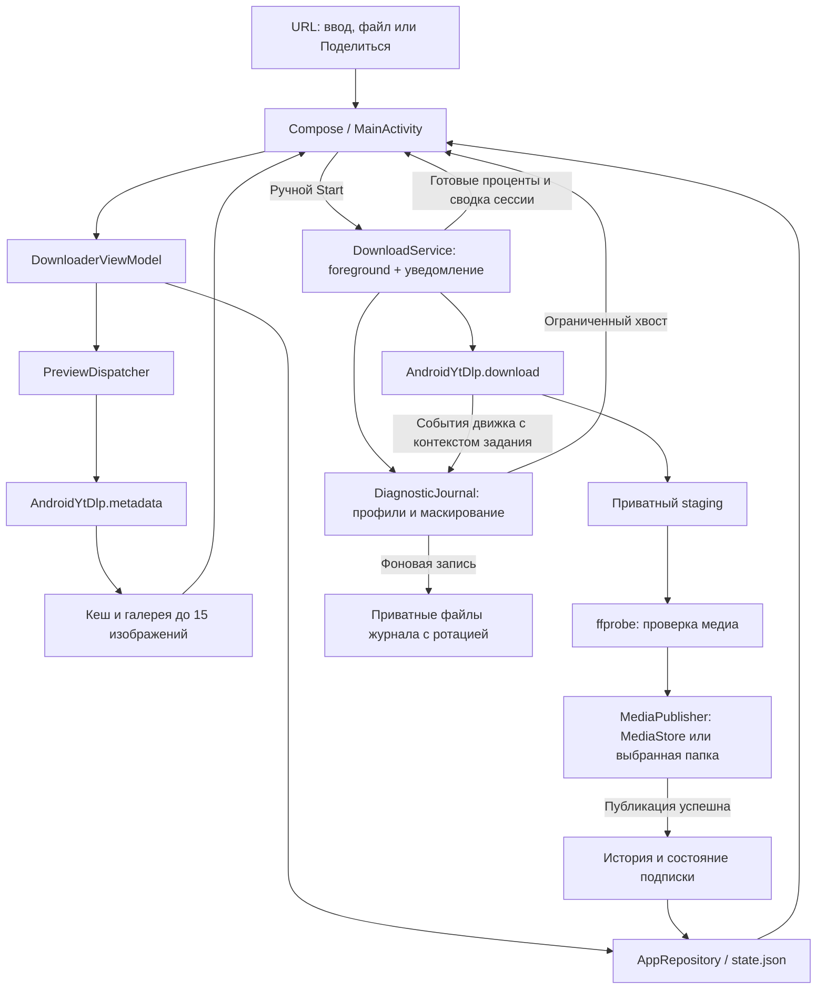
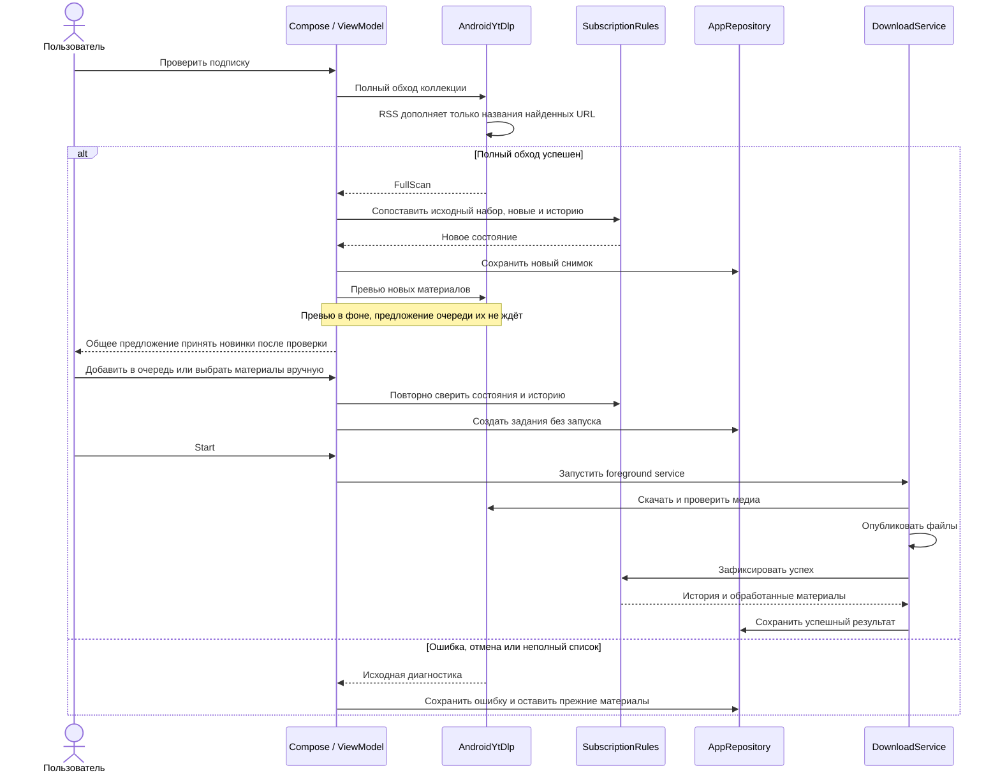

# Video Downloader для Android

Android-приложение находится в [`android/`](../../android) и написано на Kotlin с Jetpack Compose. Оно использует собственное хранилище данных и Android-рантайм yt-dlp/FFmpeg. Windows EXE на телефон не переносится. Сборка устанавливаемого APK описана в [отдельном гайде](../developer/android-build.md).

## Установка APK и обновление

Готовый отладочный APK сохраняется в GitHub Actions:

1. Открой [Android Kotlin build](https://github.com/bespalovnikita/video-downloader/actions/workflows/android.yml).
2. Выбери успешный запуск для ветки `main` и скачай внизу страницы артефакт **VideoDownloader-Android-debug**. Для скачивания артефакта через сайт GitHub может потребоваться вход. Он доступен, пока не истёк срок хранения артефактов.
3. Распакуй архив, перенеси `app-debug.apk` на телефон и открой файл. Если Android запросит разрешение установки из этого источника, выдай его выбранному браузеру или файловому менеджеру.
4. Запусти **Video Downloader**. Приложение установит свои компоненты при первом открытии.

Это устанавливаемая сборка для разработки. Публичный выпуск APK с постоянной подписью пока не настроен; Windows Release не содержит Android APK. Если артефакта уже нет, можно [собрать APK самостоятельно](../developer/android-build.md).

Обновление поверх установленного приложения сохраняет данные, **если подпись APK совпадает**. GitHub runners создают временные отладочные ключи, поэтому подпись между запусками может отличаться. Если Android отклоняет обновление из-за подписи, сначала [экспортируй резервную копию](#данные-резервная-копия-и-ограничения) и сохрани видео из каталога приложения. Затем можно переустановить сборку, импортировать копию, заново выбрать папку и cookies. Для регулярных локальных обновлений используй один и тот же ключ — [порядок подписи](../developer/android-build.md).

## Первое скачивание

1. Установи APK на устройство **Android 8.0+**, поддерживающее **arm64-v8a** или **x86_64**.
2. Открой приложение и дождись **«Подготовка загрузчика…»**: при первом запуске распаковываются компоненты рантайма.
3. Во вкладке **«Настройки»** выбери профиль и, при необходимости, папку. Нажми **«Сохранить настройки»**. yt-dlp и FFmpeg уже входят в Android-зависимости; отдельной кнопки установки FFmpeg здесь нет.
4. Во вкладке **«Очередь»** вставь HTTP/HTTPS-адрес в **«URL видео или плейлиста»** и нажми **«Добавить»**. Поддерживаются несколько ссылок, **«Вставить»**, **«Из файла»** для `.txt`/`.url` и отправка текста через Android-меню **«Поделиться»**.
5. Метаданные запрашиваются заранее. Переключатель **«Названия вместо URL»** меняет подписи строк, а нажатие на строку открывает превью. До 15 разных изображений сайта можно листать жестом и кнопками; получение метаданных не запускает скачивание видео.
6. Нажми **Start**. На Android 13+ разреши уведомления, чтобы видеть прогресс и управление загрузками вне приложения. Прогресс также виден во вкладке **«Загрузки»**.

Для одного YouTube-видео используй его адрес `https://www.youtube.com/watch?v=VIDEO_ID`, заменив `VIDEO_ID` и убрав параметр `list`. Для отдельных строк на каждый ролик плейлиста удобнее добавить плейлист как подписку по инструкции ниже. Прямой URL плейлиста в очереди — одна задача yt-dlp; он не превращается автоматически в отдельные записи истории для каждого ролика.

**«Пауза»**, **«Продолжить»** и **«Стоп»** управляют сессией. Продолжение использует сохранённые частичные файлы, когда источник допускает докачку. Новые ссылки, в том числе добавленные вручную во время скачивания, из подписки или переносимой очереди, ждут следующего **Start**. У готового задания есть кнопка **«Открыть файл»**; также результат доступен через меню задания и историю. Нажатие на саму карточку очереди по-прежнему открывает превью. Успешные URL видны в **«Загрузки → История»**; повторный Start для уже скачанной ссылки требует подтверждения.

## Прогресс и время сессии

Карточка задания показывает **общий процент** и текущий этап: подготовку, скачивание, обработку видео и аудио, проверку либо сохранение готового файла. Если сайт выдаёт видео и аудио отдельно, ниже виден процент текущего потока. При прямом URL коллекции также учитывается позиция материала, если yt-dlp сообщил пригодный план. Общий процент складывается из компонентов и позиции, а не копирует процент каждого нового потока.

До успешной проверки и публикации готового медиа общий процент ограничен **99%**. Завершение потока на 100% ещё не означает завершение задания: могут оставаться звук, объединение, проверка и сохранение. Когда план неизвестен, карточка прямо сообщает об ограничении оценки; `N/A` и некорректный процент не сбрасывают последнее известное значение в ноль.

Новая попытка или переход к другому качеству может честно уменьшить процент. Это видно по этапу **«Повторная попытка»**, номеру попытки и журналу. После начала обработки уже скачанных потоков приложение не начинает всё скачивание заново автоматически из-за ошибки обработки или проверки. Явный повтор неудачного задания остаётся решением пользователя.

В **«Очередь»** и **«Загрузки»** есть сводка сессии: прошедшее время, число готовых, активных и ожидающих заданий, ошибки и отмены. Общий индикатор учитывает весь принятый состав сессии, включая уже завершённые задания. Пауза входит в прошедшее время. Таймер принадлежит foreground service, поэтому Home и поворот экрана его не сбрасывают; после завершения работников и очистки временных данных время фиксируется рядом с **«Сессия завершена»**. Новый Start начинает новую сессию. Объём отражает счётчики yt-dlp, а не весь сетевой трафик устройства; если учёт очень большой коллекции ограничен, журнал показывает предупреждение об оценке. Эта сводка хранится в памяти процесса, а не восстанавливается как продолжающаяся загрузка после принудительной остановки.

## Шаблон имени файла

Во вкладке **«Настройки»** рядом с полем **«Шаблон имени файла»** нажми **«Как работает шаблон имени»**. Откроется отдельная справка с полями yt-dlp и примерами. Например, `%(title)s [%(id)s].%(ext)s` создаёт имя из названия, ID и расширения, а `%(uploader)s/%(title)s [%(id)s].%(ext)s` добавляет подпапку автора.

Используй относительный путь внутри папки вывода: абсолютные пути, URL, пустые части пути и `..` не допускаются. Краткое имя подписки и архивная дата добавляются отдельно. Доступность полей зависит от сайта; у отдельного URL из подписки поля плейлиста могут отсутствовать и заменяться на `NA`. Сохраняй `%(ext)s`, чтобы расширение соответствовало выбранному формату. Изменение шаблона не переименовывает уже скачанные файлы.

## Перенос очереди между устройствами

Во вкладке **«Очередь»** нажми **«Перенос очереди → Копировать очередь»**, а на другом Android- или Windows-клиенте — **«Перенос очереди → Вставить очередь»**. Переносятся URL, названия и порядок всех строк. Новые строки добавляются к существующим и ждут **Start**, в том числе при работающей загрузке. Обычная **«Вставить»** также распознаёт текст очереди.

Для большой очереди выбери **«Перенос очереди → Сохранить .vdqueue»**, передай файл и открой его через **«Загрузить .vdqueue»** или **«Из файла»**. Общий предел буфера обмена — 262 144 символа. Настройки, история, cookies, файлы и связь с подписками не переносятся. Подробные шаги и ограничения — в [инструкции переноса Windows ↔ Android](queue-transfer.md).

## Где лежат файлы

| Настройка | Каталог |
| --- | --- |
| По умолчанию, Android 10+ | Системные **Загрузки / VideoDownloader** через MediaStore |
| По умолчанию, Android 8–9 | Внешний каталог приложения `Android/data/ru.bespalov.videodownloader/files/Movies` |
| **«Выбрать папку»** | Каталог, которому пользователь выдал доступ в системном диалоге Android |

Материалы подписки получают подпапку с её кратким именем: например, выбранная папка `Video` и подписка `123` дают `Video/123`. При архивировании добавляется каталог даты. Переименование подписки меняет имя для новых заданий, а уже созданные задания сохраняют выбранное имя. Изменение настроек не переносит существующие видео.

Сначала файл скачивается в приватный staging. Приложение проверяет медиа через ffprobe, затем публикует его в конечный каталог. История и состояние **«Обработано»** появляются после успешной публикации. Существующие результаты сохраняются; для повторной копии подбирается свободное имя.

Каталог приложения на Android 8–9 удаляется вместе с приложением. Для файлов, которые должны пережить удаление приложения, заранее выбери обычную пользовательскую папку. При установке обновления с той же подписью данные приложения сохраняются.

## Подписка и RSS

1. Открой **«Подписки → Добавить»**.
2. Укажи **«URL канала / плейлиста»**. Источник должен поддерживать полное перечисление коллекции установленной версией yt-dlp.
3. Если есть лента, укажи её отдельно в **«RSS / Atom — необязательно»**. Одного URL RSS недостаточно: основной адрес коллекции обязателен.
4. При желании задай **«Краткое имя папки — необязательно»**. Пустое имя заполнится по метаданным источника после проверки.
5. Выбери, как обработать существующие материалы: без флажка текущий набор станет точкой отсчёта; с флажком **«Все имеющиеся материалы добавить в очередь»** он будет добавлен в очередь.
6. Нажми **«Добавить и проверить»**. При следующих запусках используй **«Проверить»** или **«Проверить все»**.
7. Если после проверки есть новые материалы, приложение предложит принять их в общую очередь. Нажми **«Добавить в очередь»** либо **«Не сейчас»**. Для выборочного приёма открой материалы подписки, в фильтре **«Новые»** отметь нужные строки и нажми **«В очередь (N)»**, где `N` — число выбранных. Скачивание начинается кнопкой **Start**.

Проверка выполняет полный обход через yt-dlp. RSS/Atom только дополняет отсутствующие названия для **точных URL, уже найденных этим обходом**. Ошибка ленты не подменяет полный список укороченным. Ошибка, отмена или неполный обход сохраняют прежний успешный снимок. Общий предел — 10 000 материалов; обычный обход ограничен тремя минутами, специальный сборщик публикаций Pornhub — 500 страницами и 15 минутами. Ограничения сайта и авторизации могут сократить доступную коллекцию или привести к ошибке проверки.

После успешной проверки превью новых и поставленных в очередь материалов запрашиваются в фоне. Нажатие на строку или **«Сведения»** открывает название, точный URL, подписку, состояние и время обнаружения материала, а по готовности — до двух изображений. Если картинок больше, кнопка **«Все превью (N)»** раскрывает прежнюю галерею до 15 изображений. Внутри доступны **«Копировать URL»** и **«Открыть URL»** выбранного видео; просмотр не запускает скачивание.

Если точный URL ранее успешно скачан вручную, подписка учитывает эту историю и повторно не предлагает его как новый. Для успеха из другой подписки предусмотрено однократное уведомление. Разные варианты URL одного ролика не объединяются по ID.

Проверки запускаются вручную. Расписания и автоматического запуска скачивания нет. Cookies можно подключить через **«Настройки → Cookies → Импорт .txt»**; [инструкция для Android](cookies.md#android-cookies). RSS-клиент и клиент изображений не импортируют этот браузерный cookie jar.

### Исходный набор и новинки

Без импорта существующих видео первая проверка создаёт **«Исходный набор»**. Открой подписку и выбери фильтр **«Исходный набор»** или **«Все»**, отметь нужные материалы и нажми **«В очередь (N)»**. Они ждут ручного **Start**; просмотр списка не принимает их автоматически. При добавлении новой подписки с флажком импорта существующих видео первоначальный набор принимается в очередь по этому выбору.

Следующие проверки находят ранее неизвестные точные URL. После окончания **«Проверить»** или всего запуска **«Проверить все»** один раз появляется окно **«Новые материалы подписок»** с общим числом материалов и источников. В предложение входят все ещё не принятые материалы **«Новое»** успешно проверенных подписок, включая найденные ранее. Исходный набор, пропущенные и обработанные материалы сюда не входят. Приём первоначального архива по флажку импорта остаётся отдельным действием.

**«Добавить в очередь»** повторно сверяет состояния и историю, затем принимает подходящие материалы без запуска загрузки. **«Не сейчас»** или закрытие окна оставляют их новыми. Отменённый запуск общего предложения не показывает; источники с ошибкой проверки в него не входят. После отказа можно принять нужное вручную либо дождаться следующей успешной проверки.

Каждый ручной запуск пока выполняет полный обход; окна последних 20 публикаций и флажка **«Полная проверка»** Windows здесь нет. Если добавилось 100 видео и полный обход укладывается в лимиты, будут обнаружены все 100. Список материалов после проверки повторяет порядок источника. Ранее известные записи, отсутствующие в текущем результате, сохраняются в конце со своими решениями. Для старых подписок достаточно выполнить обычную проверку; удалять и создавать их заново не нужно.

Точный адрес источника показан над фильтрами: его можно выделить либо нажать **«Копировать URL подписки»**. Такая же команда есть в меню источника **⋮**. Это адрес канала или плейлиста, отдельно от URL выбранного видео.

Меню источника **⋮** также позволяет переименовать папку, приостановить или возобновить проверки, посмотреть диагностику и удалить подписку. Удаление сохраняет обычную очередь, историю и скачанные файлы. Ни возобновление, ни открытие приложения не запускают проверку или скачивание.

## Скачивание при сворачивании

После **Start** загрузками владеет Android **foreground service** с постоянным уведомлением. У неё собственные задания, независимые от экрана приложения. Переход на главный экран, переключение на другое приложение и пересоздание Activity при повороте не служат командой остановки. Из уведомления можно вернуться в приложение и управлять сессией. Служба удерживает частичный WakeLock на время активной работы, чтобы выключение экрана само по себе не переводило CPU в сон посреди загрузки.

Это не обещание бесконечной работы при любых действиях системы. **«Остановить принудительно»**, остановка приложения через системный диспетчер активных приложений и перезагрузка устройства завершают процесс. Загрузка не запускается самостоятельно после них: открой приложение, восстанови очередь и нажми **Start**. На Android 15 при `targetSdk 35` фоновые службы `dataSync` имеют общий системный бюджет до **6 часов за 24 часа**; при системном таймауте служба сохраняет прерванное состояние и завершает работу. Новое открытие приложения пользователем сбрасывает этот бюджет согласно правилам Android.

Некоторые прошивки дополнительно ограничивают фоновые приложения. Если загрузки обрываются именно на твоём телефоне, проверь системные **Настройки → Приложения → Video Downloader → Батарея** и разреши фоновую работу; названия пунктов зависят от производителя. Приложение не требует отключать энергосбережение для всей системы.

### Как проверить сворачивание на своём устройстве

1. Добавь достаточно длинное доступное видео и нажми **Start**. Дождись, когда начнёт расти объём скачанного.
2. Нажми **Home** или переключись на другое приложение. Проверь, что уведомление загрузки остаётся, а индикатор прогресса в нём обновляется.
3. При желании выключи экран на минуту. Затем открой приложение через уведомление и проверь продолжающийся прогресс.
4. Дождись завершения: результат должен открываться из **«Загрузки»**, а точный URL — появиться в истории.

Автоматический сценарий [`foregroundDownloadCompletesAfterPressingHome`](../../android/app/src/androidTest/java/ru/bespalov/videodownloader/AndroidPortInstrumentedTest.kt) использует реальный медленный HTTP-сервер в тесте, настоящий Android-рантайм и переход на домашний экран Android. Он подтверждает остановленную Activity, рост полученных байтов в фоне, готовый читаемый файл и историю без возврата в приложение. Команда запуска — в [гайде сборки](../developer/android-build.md#проверки). Само наличие теста не означает, что он пройден на каждой модели телефона.

## Данные, резервная копия и ограничения

Очередь, настройки, подписки и история находятся в приватном `files/state.json`. Превью имеют собственный кеш, cookies — приватную копию импортированного файла. Windows-файлы `session.json` и `subscriptions.json` не являются форматом Android-импорта.

Для обмена очередью с Windows используется отдельный общий формат [`.vdqueue`](queue-transfer.md). Он переносит только URL и названия; резервная копия Android остаётся отдельным форматом состояния.

В **«Настройки»** доступны **«Экспорт резервной копии»** и **«Восстановить из резервной копии»**. Копия переносит состояние приложения, но не содержит видео и сам файл cookies. После переноса заново выбери каталог вывода и импортируй cookies: разрешения системного выбора файлов не переносятся между устройствами. Повреждённый снимок открывается без автоматической перезаписи; для восстановления можно явно импортировать исправную копию.

Android-рантайм отличается от Windows-сборки yt-dlp: браузерная эмуляция `--impersonate chrome` здесь недоступна. Наличие экстрактора в yt-dlp не гарантирует одинаковую доступность каждого сайта на телефоне. При ошибке проверь исходную диагностику в меню задания или **«Журнал»** и доступность материала в браузере; cookies не обходят все ограничения источника.

## Журнал и диагностика

Открой **«Журнал»** в верхней части экрана и выбери **«Профиль журнала»**. Изменение действует на новые события: уже записанные сообщения не исчезают, а ранее пропущенные не восстанавливаются. Тот же выбор есть в **«Настройки → Журнал → Подробность журнала»**; там его нужно подтвердить кнопкой **«Сохранить настройки»**.

| Профиль | Что записывается |
| --- | --- |
| **Только ошибки** (`Errors`) | Ошибки и предупреждения |
| **Обычный** (`Standard`) | Также основные события подготовки, попыток, завершения и управления |
| **Прогресс загрузок** (`Progress`) | Также ход отдельных заданий и общая сводка сессии |
| **Подробный yt-dlp** (`Detailed`) | Также диагностические строки движка |

Для скачков процентов при нескольких загрузках включи **«Прогресс загрузок»**, затем воспроизведи проблему. В записи задания указаны сессия, задание, попытка, `video_seq` и название либо URL. `video_seq` обозначает порядковый номер видео в очереди, а не номер сообщения журнала. События `overall` показывают состав учитываемых заданий; длинная сводка ограничивается по размеру. Для причины отказа сайта выбери **«Подробный yt-dlp»**. У неудачного задания также есть **⋮ → Исходная диагностика**, у подписки — **⋮ → Диагностика**.

Нажми **«Копировать»** или **«Сохранить…»** и выбери текстовый файл в системном диалоге Android. Обе команды берут сохранённый в памяти журнал: до **5 000 записей и 2 МиБ**. Если он слишком велик для буфера обмена, приложение предложит сохранить файл. На экране показывается хвост до **2 000 записей и 512 КиБ**. **«Очистить»** удаляет записи с экрана и из памяти, сохраняя автоматические файлы журнала.

Фоновая запись хранит `files/logs/journal.log` и две ротации `.1` / `.2` размером до **5 МиБ каждый** в приватных данных приложения. Прежние файлы сохраняются между запусками до ротации, но не подгружаются в экран автоматически; экспорт через кнопку относится к текущему журналу в памяти. Ошибка или переполнение очереди записи отображается предупреждением и не останавливает скачивание.

Время отображается в локальном формате `ГГГГ-ММ-ДД ЧЧ:ММ:СС.мс`, без часового пояса и печатного счётчика `#...`. Настоящие переносы строк сохраняются. Секретные параметры, авторизация и содержимое cookies маскируются перед записью, копированием и экспортом; публичные идентификаторы вроде YouTube `v` / `list` и Pornhub `viewkey` остаются видимыми. Перед отправкой журнала всё равно проверь названия, пути и приватные адреса.

Если название есть, а обложки нет, текстовые сведения остаются доступными. Android использует собственный кеш превью до 72 часов; правило Windows о повторе ошибки картинки через минуту сюда пока не перенесено. Повторный выбор строки не гарантирует немедленный сетевой запрос. Не очищай данные приложения ради обложки: это затронет очередь и подписки. Перед отправкой диагностики проверь приватные адреса и не прикладывай cookies. Другие рецепты — в [устранении проблем](troubleshooting.md).

## Ошибка YouTube HTTP 403

1. В **«Настройки → Загрузчик и данные»** посмотри фактическую версию yt-dlp. Нажми **«Обновить yt-dlp»**, дождись результата и повтори задание. Настройки cookies и папки вывода сохраняются.
2. В меню **⋮** задания открой **«Исходная диагностика»**. Общая русская подсказка об HTTP 403 не различает отказ страницы, авторизации и сервера медиа. В **«Журнал → Копировать»** можно скопировать журнал вместе с версией движка; перед отправкой убери приватные ссылки и токены.
3. Открой то же видео в браузере на телефоне. Если требуется вход или подтверждение возраста, [подключи свои cookies](cookies.md#android-cookies). Файл cookies не нужен каждому публичному видео.
4. Если включён VPN, сравни результат с разрешённым прямым подключением или другой своей сетью. Это проверка зависимости от сети, а не гарантированный способ исправить 403.

Для YouTube важны актуальный экстрактор и JavaScript-рантайм. APK содержит QuickJS, а официальный zipimport yt-dlp включает EJS; отдельно включать случайный `player_client` или устанавливать сторонние плагины наугад не требуется. Ограничения аккаунта, IP и PO-токенов могут оставаться и с актуальным движком. См. [официальное руководство yt-dlp по EJS](https://github.com/yt-dlp/yt-dlp/wiki/EJS) и [PO-токенам](https://github.com/yt-dlp/yt-dlp/wiki/PO-Token-Guide).

## Взаимодействие компонентов

Вернуться к [каталогу пользовательских инструкций](README.md) или [описанию проекта](../../README.md).
